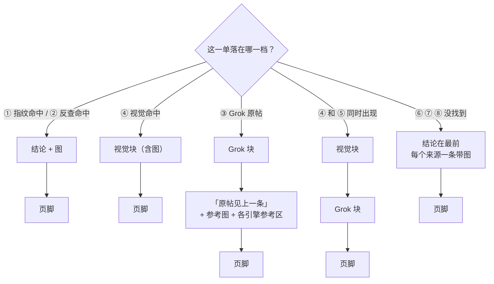
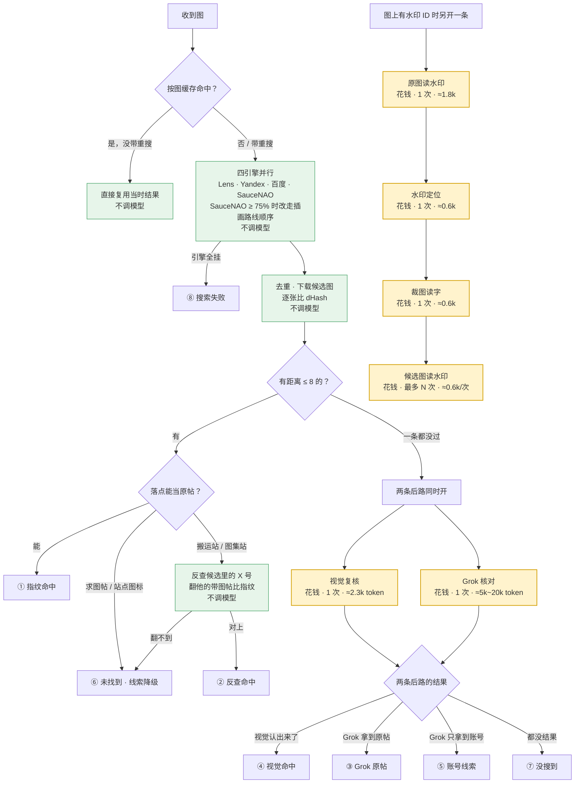
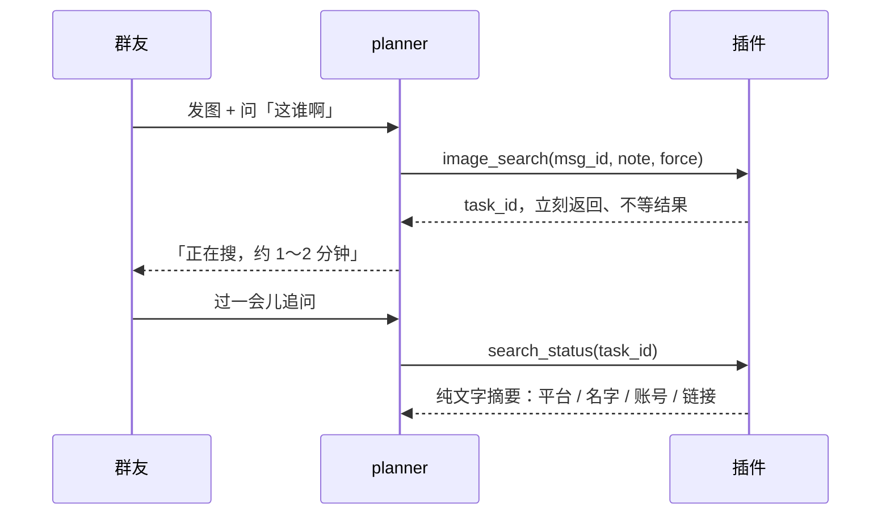
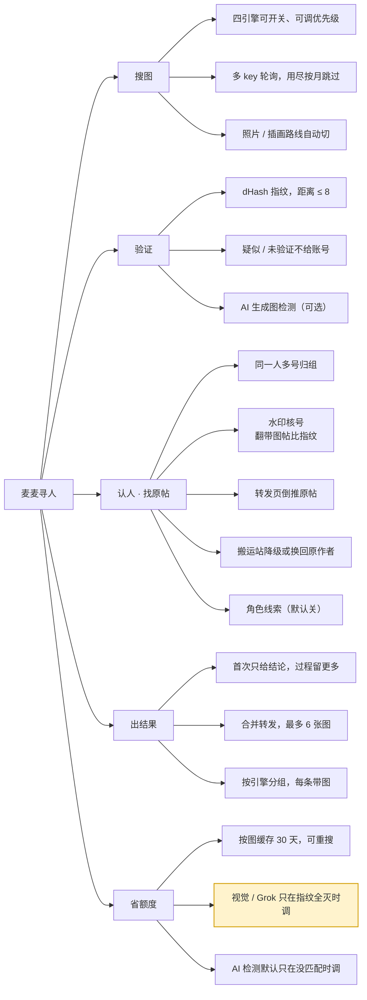
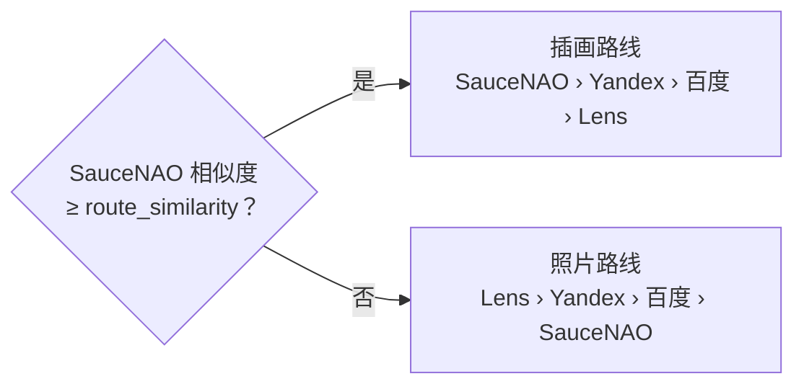
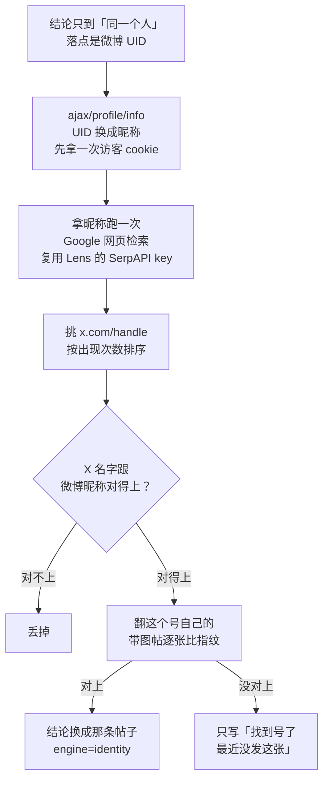

# 麦麦寻人（com.fsqhn.image-searcher）

把群里的图片反查原始出处与社交账号：四家以图搜图引擎同时开跑，候选图逐张跟原图比一次指纹，只有确实是同一张图才会给出账号。

也可以叫「麦麦找鸡」——本质一样，都是搜图，都是按图找出处、找人。

主要面向真人 coser 图的找原作者与 X 账号，不依赖人脸识别，图里没露脸也能用。

> **本插件由 AI 编写。** 已经在作者自己的 MaiBot 上跑通并做了有限的实际验证，但**不保证在你那边的 MaiBot、适配器、网络环境下表现一致**。遇到问题请看[详细日志与反馈](#详细日志与反馈)。

> 🧩 **还在用 MaiBot 0.12.x？** 那个版本用的是旧插件体系（manifest v1、没有 WebUI），装不了这个插件。0.12 特供版单独一个仓库：**[fsqhn/com.fsqhn.image-searcher-012](https://gitee.com/fsqhn/com.fsqhn.image-searcher-012)**，功能一致，装了就能用。

## 目录

- [它长什么样](#它长什么样)
- [它是怎么搜的](#它是怎么搜的)
- [模型也能直接调用](#模型也能直接调用)
- [运行时行为](#运行时行为)
- [功能](#功能)
- [安装](#安装)
- [申请 API / 密钥](#申请-api--密钥)
- [代理（很重要，建议先配好）](#代理很重要建议先配好)
- [配置项](#配置项)
- [怎么触发](#怎么触发)
- [详细日志与反馈](#详细日志与反馈)
- [怎么从结果里捞出命中的那条](#怎么从结果里捞出命中的那条)
- [已知限制](#已知限制)
- [文件结构](#文件结构)
- [测试](#测试)
- [声明](#声明)
- [关于 PAI](#关于-pai)

## 它长什么样

### 搜到了

命中（指纹、视觉复核、Grok 任一）时只有一条转发：标题、结论、页脚。

```
🔍 麦麦寻人结果
🌐 平台：X (Twitter)
🔍 匹配：指纹一致（距离 2）
👤 名字：示例用户
🆔 账号：@example_user
🔗 https://x.com/example_user
[配图]
任务编号：s-20261103-0832-d7d9（保留 1 天）
回复「麦麦寻人 更多 s-20261103-0832-d7d9」查看全部结果
重新搜一遍（忽略缓存）：发图时带上「麦麦寻人 重搜」
```

首次回复只给最终结果：平台、匹配结论、名字、账号、链接。**「怎么找的」不放在这里**——匹配路线、AI 检测、耗时、候选条数统一留在「更多」里（`🖼 匹配路线：照片`、`🤖 AI 检测：未执行`、`耗时 32.5 秒，共 49 条候选`）。像「这是 @xxx 的回复页，顺着她的回复找到原帖」这种过程描述也只进「更多」，首次回复把 `🔍 匹配` 收成一句「指纹一致（距离 0）」。

复用缓存时，标题会变成 `🔍 麦麦寻人结果 · 缓存`，页脚多一行「💾 这张图之前搜过，直接复用了当时的结果（引擎没有重新跑）」。

**第一次回复长什么样**：标题并进结论节点，整条转发只有两个节点（结论 + 页脚的任务编号），不会再出现一个只有「🔍 盆地找鸡结果」的空节点。x.com 的页面标题固定写成「名字 (@handle) / X」，抽走账号后会把空括号和 ` / X` 尾巴清掉，所以「👤 名字」只写人名。同一句话不会说两遍：比如那条水印线索里，「可能读错」只出现一次。「跟这张图对上的那条」也只标给指纹真对上的号——视觉判的「同一个人」是同一人，不是同一张图，不挂这句。

### 没找到

参考区按引擎分组，每个引擎一个节点，组内按指纹距离从近到远排，**每个引擎的第一条都带图**——就是该引擎最接近的那张；哪怕它同时是顶部那张参考图，也会在该引擎列表里再出现一次：

```
🔍 麦麦寻人结果
⚠️ 未找到可靠出处
已比对 12 条候选，最高指纹距离 19，均未通过阈值。
视觉复核了 16 张候选，没有发现同一个人。
另有 3 条是同角色或同款服装的图（指纹距离 12～17），不是这张照片本身，见参考区。
另有 1 条是站点账号头像（dzmm.ai）：指纹对上了，但那是头像不是原帖，点开页面通常看不到这张图。
📋 参考图（引擎候选里跟原图最接近的一张，指纹距离 19，不是同一张；不是视觉方案挑的，也不是 Grok 给的）
[图]

▍Google Lens（3 条）
1. [X (Twitter)] （账号未确认） · 指纹不符（距离 31）
[图]
   https://x.com/someone/status/123
2. [微博] （账号未确认） · 未验证
   https://weibo.com/...
3. ...

▍Yandex（2 条）
1. ...

🖼 匹配路线：照片
🤖 AI 检测：未执行
任务编号：s-20261103-0832-d7d9（保留 1 天）
回复「麦麦寻人 更多 s-20261103-0832-d7d9」查看全部结果
重新搜一遍（忽略缓存）：发图时带上「麦麦寻人 重搜」
```

参考图那一行会随来源变：来自 Grok 帖子配图就写「Grok 帖子配图里跟原图最接近的一张」，是视觉方案挑中的那张就写「视觉方案挑中的那张」，两者都不是会明说「不是视觉方案挑的，也不是 Grok 给的」。

只有通过指纹验证的候选才会给账号；没下载比对成功的标「账号未确认」，避免把别人的号当成原作者发出去。

**没搜到时长什么样**：第一句就直说「⚠️ 没搜到：公开索引里没有这张图的原帖」，第二句给「各引擎条数 / 原始条数 / 去重后条数 / 最近一条距离与落脚站」，让你一眼知道这单到底搜了多少、差多远。

候选落在付费图包页时（fantia、Patreon、FANBOX、DLsite，以及 4play、秀人这类打包卖图集的站），结论后面还会补一句「💸 有候选落在 … 这种付费图包页，这类图通常只在订阅里，公开索引没有原帖，换引擎也一样」——这类图不是搜不到，是本来就不会出现在公开索引里，不用再换引擎试。已经拿到她售卖页时这句不写，那一条已经把平台和链接摆出来了。

后面按来源各列一条，都带那张图：Google Lens、Yandex、百度、SauceNAO 各一（同一张图出现在多个引擎时只留距离最近的那条），再看视觉复核和 Grok——它们不是引擎，会各自说清做了什么努力，比如视觉拼了几张候选、挑中几条、为什么降级，Grok 换了几组关键词、核了几条帖、最近的距离是多少。视觉挑中的那条如果就是上面某个引擎那条，它只说「最像的就是上面 ▍X 那条」，不重复发图。

**页尾会补一张你发的原图**：群里连着好几单时，一屏结果分不清是哪张图搜出来的，所以合并转发的最后一屏固定写「🖼 本次搜索的原图」并附上它。回「更多」时不再重复发这张（首次回复里已经有）；旧任务和按图缓存命中的结果不存原图，页尾就只有文字。这张原图只在内存里，不占任务表体积。

**6 张图的上限还在**：NapCat 对单条合并转发的图片总量有上限（实测 6 张能过、13 张被拒），没搜到这套排版本来就凑得满 6 张（4 个引擎 + 视觉 + Grok），所以页尾带原图时会单独拆一块——图少的时候发送层自动合回一条，图多的时候页脚（连着原图）单独一条跟上，不会因为多这一张让整条转发失败。

Grok 已经把原帖给出来的时候不算「没搜到」，仍按「找到 X 上的原帖」输出。如果开了 AI 检测且置信度高，会提示可能是 AI 生成图。

### 回复「更多」

重发同一份结果，每个引擎展开到 `more_limit` 条，**每个候选都带上自己的图**，方便逐条对照。带任务编号（`更多 s-20261103-0832-d7d9`）可以指定重发哪一次，群里同时有好几次搜索时用它。

**发到哪个会话，就回哪个会话**：结果回复在「发这条指令」的会话里，不是当初搜图的会话。群里搜、私聊里要「更多」，结果回私聊；私聊里拿群里的任务编号要，也回私聊。裸「更多」取的是**本会话**最近一次搜索，本会话没搜过就静静不吭声（免得群里每句「更多」都蹦提示）。

展示图会压到 60KB 左右；图片太多（超过 6 张）时会自动按引擎拆成几条转发，每条带引擎名和 1/N 页码。

模型（planner）那一侧只拿到纯文字摘要，不带图，不阻塞对话。

### 回复「直发」

合并转发卡片偶尔不被客户端画出来——插件这边只能拿到一个 bool，服务端存着、群里却看不见。这种时候补一句 `直发` 就行：把同一份结果换成**一条普通图文消息**重发，文字结论在前，最多跟三张关键图；「更多」里那份完整候选照旧在，不影响。

同样支持带任务编号（`直发 s-20261103-0832-d7d9`）指定是哪一单；不带编号取本会话最近一次搜索，本会话没搜过就静静不吭声。也认「单条」「文字」两个写法。

### 回复「帮助」

`帮助`（也认 `help`、`?`）纯文字回一段用法，把发图搜、重搜、更多、直发、xid 核对和结果保留时长一次讲完，例子里写的是真指令，照抄能触发。

### 一条转发由几个节点拼起来

节点数量随结论走，看这一单落在哪一档。



① ② 那条在 Grok 有配图时会多一个节点；其余按图里的顺序拼。

另外有三种「修饰」，不改变结论，只改外观：命中缓存时标题加 `· 缓存` 并补一句 `💾 这张图之前搜过，直接复用了当时的结果`；AI 检测概率过线时标题换成 `· 疑似 AI 生成`；回「更多」时标题变 `· 全部候选`，这时才会显示 `🖼 匹配路线：照片/插画` 和 AI 概率那两行。

### 每条候选上的状态词怎么读

结果里每条候选都会带一个状态词，下面这张表是它们的含义，以及该不该当成结论。

| 状态 | 含义 | 该不该信 |
|---|---|---|
| 指纹一致（距离 ≤ 8） | 候选图和你发的图基本是同一张 | 可以信，账号通常就是原作者 |
| 找到 X 上的原帖（Grok） | Grok 给出具体帖子，插件逐条拉回配图比指纹，真对上某一条才算 | 可以信，点开帖子对照一眼 |
| X 搜索指向某账号（Grok） | Grok 只给到账号主页，或给的帖子配图全对不上（参考图会标出最近的距离，例如「指纹距离 24，不是同一张」） | 当线索；可能只是同一人的另一张图，也可能只是同角色 |
| 视觉复核 | 指纹没通过，但视觉模型判断是**同一个人**；结论带「模型挑的、可能认错、请自行核对」 | 当线索；模型也会看错，点进去确认 |
| 视觉复核（降级为疑似） | 视觉挑中了，但那条是电商商品页、找不到可核对的账号、handle 只是平台编号（B 站 `BV…` 视频号），或只落在抖音这类平台页面上解析不出账号；备注会点名是哪个站 | 基本只能当同款/同场景，别当人 |
| 图上水印 | 视觉和 Grok 都读，两个号都翻它自己的带图帖比指纹；查无此人时按近似拼写（`uwy→ww` 这类）再试，命中要求仍是「它自己的帖子里有这张图」 | 命中可当结果；没命中当线索 |
| 图集站标的来源 | 视觉挑中的落点是 `4play` / `v2ph` 这类搬运站时，抓那一页读出站方标的 IG / X 账号 | 准头比水印好，但站方也会标错，仍要自己点开核对 |
| 发布者主页标的账号 | 结论落在 `picazor` 这类站时，帖子页本身没有账号，插件再翻一层到它的发布者主页（如 `/en/<名字>`），把主页上挂的 X / IG 捞回来 | 比帖子页 meta 硬（那是站方给「这个主页属于谁」的链接），但同样点开核对 |
| 疑似（距离 9~20） | 高度相似但可能有裁剪、压缩、二次编辑 | 当线索，别当结论 |
| 指纹不符 | 搜出来的是同题材的另一张图 | 忽略 |
| 未验证 / 账号未确认 | 候选图下载失败或不是图片（常见 403、防盗链） | 只能点链接自己看 |

Yandex 结果的图床在国内直连更快，插件对这类地址会直连优先、失败再走代理；其他站点则相反，先代理后直连，两条线路都试过才判为「未验证」。

## 它是怎么搜的

一次搜索按固定顺序过几道关，每一关都可能提前结束，也可能把结论降一级。图里写着「**花钱**」的格子才会调模型，其余全是免费的网络请求与本地比对。八种结论落在哪一格、要不要花钱，看下面这张图和表。



图里只有三处分叉：按图缓存命中就直接复用，指纹一条都没过才开两条后路，落点站不站得住决定要不要再翻一层。

### 八种结论分别是什么

| 结论 | 落在哪一步 | 结果里会看到什么 | 模型调用 |
|---|---|---|---|
| ① 指纹命中 | 距离 ≤ `hash_threshold`，落点是帖子页；插画是 SauceNAO ≥ 75% | `🔍 匹配：指纹距离 3，指纹一致` + 平台 / 名字 / 账号 / 链接 | 0 次 |
| ② 反查命中 | 命中的是搬运页、图集页，再翻到本人的带图帖 | `🔎 结论是翻出来的：搬运站那条只是转贴，@xxx 自己的带图帖里有这张`；微博是 `🔍 匹配：转载页正文反查到原帖`；水印是 `🏷 图上印的 ID 就是这个号…已按它核对` | 0 次 |
| ③ Grok 原帖 | 指纹全灭，Grok 核到具体那条帖子 | 单独一块：`✅ 找到 X 上的原帖`、名字、@账号、主页、帖子地址、`🔍 依据`；配图注「配图非同图，仅供参考」 | Grok 1 次 |
| ④ 视觉命中 | 指纹全灭，视觉判「同一个人」，落点站得住 | `🧠 没找到同一张图，但视觉复核认为是同一个人` + 它给的理由 + `⚠️ 模型挑的，不是指纹比对，可能认错` | 视觉 1 次（Grok 同时在跑） |
| ⑤ 账号线索 | 只要到账号主页，没核到原帖 | `🔎 X 搜索指向这个账号，但没核到原帖` + `存疑参考（配图相似但非同图…）` | Grok 1 次（视觉同时在跑） |
| ⑥ 未找到·线索降级 | 距离够近，但落点是转载页、站点图标、别人在求图，反查也翻不到 | `⚠️ 未找到可靠出处`、`最近的一条指纹距离 5，但那条不能当原帖`、`另有 12 条是同角色或同款服装的图（距离 18～31）` | 0 次 |
| ⑦ 没搜到 | 一条都站不住，两条后路也空手 | `⚠️ 没搜到：公开索引里没有这张图的原帖` + 各引擎条数、原始 / 去重条数、最近那条距离；每个引擎各 1 条带图 | 视觉 + Grok 各 1 次 |
| ⑧ 搜索失败 | 引擎全挂，或候选图根本取不到、解不开 | `🔍 盆地找鸡 · 搜索失败`、`候选图都没能取到或解码，无法验证` | 0 次 |

①～⑤ 都会带同一套身份行（有就显示）：`🌐 平台`、`🔍 匹配`、`👤 名字`、`🆔 账号`、`🐦 X 主页`、`🔗 链接`。图集站会换成 `👤 名字（图集站标注的模特名）` + `📦 套图`，B 站 BV 号显示成 `🎬 视频号`，被封的号加一行 `已被 X 封禁（用户 ID …）`。

② 那条要单独讲清顺序：引擎先命中一个距离够近的图，落点是搬运站 / 图集站；落点若是站点的标签／分类列表页（`/tag/xxx/`、`/category/xxx/`、`/collection/xxx/`、`?s=` 这类；`/page/2/` 不算——文章和图集自己也分页，那是同一篇的第二页），那不算出处——一页全是缩略图，插件会顺着命中那张缩略图找到它所属的那篇帖子（缩略图外层就包着那篇的链接），取那篇的主图（`og:image`）再核一次指纹，对上了才拿它当落点，对不上就仍旧只算「疑似」，最多看两页、每页两跳；挖到的链接本身还是列表页、或那一篇没有自己的主图时一律放弃，**不会退回列表页那张缩略图**——那就是原图本身，比出来永远是距离 0；插件先看**标题里的作者名**——资源站常写成「染三ran3 - 作品名」，把它按重复拼接展开成几个候选号（`ran3`、`ran3ran3`、`ran3ran3ran3`），逐个查过去，**显示名必须和标题里的名字对得上**才算（`ran3ran3ran3` 的显示名是「染三 ran3」，而 `ran3` 是个 1 粉的空号；标题开头的方括号是分类标签，像「[Cosplay] ran3 - …」、或方括号被站点吃掉只剩「Cosplay] ran3」，都要先剥掉再取名字，否则会拼出 `Cosplayran3` 这种谁都搜不到的号；这一步默认问一次 MaiBot 的文本模型（`[title_author]`，任务组 `utils`），模型没回或答复解析不了时才退回这套规则；走模型时结果里会把「染三ran3」拆成名字「染三」+ 账号 `ran3` 分开写，并注明名字是模型从页面读完的）；对上的号再翻她自己最近的带图帖逐张比指纹。**一次命中好几个搬运站时，每个站都会看一遍**：落点在网页上、没账号、距离在 12 以内的候选（最多 5 个，同域名只留一条）会一起交给模型——所有页面的标题和正文装在**一次**请求里问完，模型这轮什么都没给出才退回 best 单页再问一次，一次搜索最多两次模型调用；各站抽到的名字逐个按上面的流程核，谁先对上用谁。标题里没有名字、或名字没对上号时，退回翻候选里那几个 X 号。③ 上面这些步骤跑没跑、为什么没跑，全都记在 `outcome.trace` 里，回「更多」时单独给一段「🧭 这次是怎么找的」——以前「没触发」和「触发了没读到」在群里长得一模一样。首次回复不放这段，只留结论（用户 11-14 定过的口径）。对上才把结论换成那条帖，对不上就降级成线索、落进 ⑥。视觉模型不做这条反查——它判「同一个人」但落点是转发页时只会降级成参考区里的一条。

**落在平台搜索页上时（`search.bilibili.com/all?keyword=…`）**：那一页是 JS 渲染的结果列表，页面本身解析不出发布者，指纹又只到「疑似」那一档，照老逻辑整单就是没找到。现在会拿 URL 里那个关键词去 B 站检索接口反查账号（`core/bilibili.py`，wbi 签名），再把这些号自己投稿的封面逐张比指纹，对上了才把账号页当结论——粉丝数、播放量一概不参与，同名的号只靠图区分。反解到号但封面都对不上时，结论里会多一行「🔎 搜索页反解：…」，让人看得出这个方向试过了；封面没下下来会单独说「投稿封面没下下来」，不跟「图对不上」混为一谈。结论落在 UP 主主页时，那行会写明「这是主页、不是那一篇投稿」，而且主页不许顶掉距离不比它差太多的真实帖子（`Candidate.account_page`，帖子在 +2 以内优先）。开关是 `[plugin] search_page_resolve`（默认开，异常一律静默降级，反解整段封 45 秒）。

**候选 URL 里写着别的平台账号时（`[plugin] other_platforms`，默认开）**：`extract.match_account()` 一直能把 `tiktok.com/@xxx/video/…`、`space.bilibili.com/<mid>`、`weibo.com/u/<uid>` 解析成账号，可反查只认 X（`_hunt_repost_author` 走 `_repost_x_handles()`），这些号从头到尾没人读——838e 那条 `@starrychibun` 就是这样丢的。现在分两路：① **候选里写明的号全部收进线索**（`core/platforms.py`，小红书和抖音这轮不做），能核图的顺手核——B 站拿这个号的名字再检索一次、投稿封面比指纹；微博拿 UID 换昵称粉丝，有登录 cookie 才翻得了带图帖；核到就换结论（B 站给 UP 主主页，同样标明「不是那一篇投稿」）。② **结论落到 X 号时**，拿这个 handle 去微博和 B 站各搜一次同名，只当线索，核不到图绝不改结论。**TikTok 和 Instagram 只能当账号线索**：2026-11-23 实测 TikTok 的 oembed 回 200 但 JSON 里只有 iframe、没有 `thumbnail_url`，B 站的 `x/web-interface/view` 一律 412，公开图只剩检索结果里的投稿封面。整段封 36 秒、最多核两个号，异常只丢这一路。

### 钱花在哪

搜图、去重、指纹比对、搬运页和微博反查，全都不调模型、不产生模型费用。真正扣钱的只有下面这几处：

| 调用点 | 次数 | 大概 token | 依据 |
|---|---|---|---|
| 视觉复核（拼 16 张对照图） | 每次搜索最多 1 次 | ≈2.3k | 线上 `llm_usage` 实测均值 2,613，取整 |
| 原图读水印 | 有水印 ID 时 1 次 | ≈1.8k | 单图长边压缩后实测 |
| 水印定位 | 1 次 | ≈0.6k | 小图定位、max_tokens 120 |
| 裁图读字 | 1 次 | ≈0.6k | 同上 |
| 候选图读水印 | 每张候选 1 次 | ≈0.6k | 同上 |
| Grok 核对 | 每次搜索最多 1 次 | ≈5k~20k | 一次调用内含多轮工具检索，按轮数浮动 |

- **命中的单子 0 元**：指纹命中、缓存复用、搬运页反查都不调模型，只消耗引擎的调用额度。
- **没命中的单子约 ¥0.10～0.28**：Grok 一次 ¥0.10～0.28（官网价口径，走中转通常更低），视觉一次约 0.2 分钱；两路同时开，谁也省不掉谁。
- **水印链单独算**：只在图上真读到 ID 时才跑，一串 4～N 次、一两千 token，几分钱。
- **引擎额度另算**：Lens 免费 250 次/月、SauceNAO 免费 100 次/天，超额要充；Serper 是预付总量，Lens 一次扣 3 次。这部分跟模型账单分开。

### 四个引擎

Google Lens（SerpAPI）、Yandex、百度、SauceNAO 四家同时以图搜图，各交回一批带图页面，取几条由各引擎的 `max_results` 决定；引擎实际返回的往往远不止这几条，一次搜索拿到一百多条原始结果是常事，所以「取多少」就是成功率的第一道瓶颈，深度检索正是在这里多取。SauceNAO 相似度达到 `route_similarity`（默认 75）时按插画路线走，它没认出来就没有 pixiv 候选可给。

### 指纹验证

候选图逐张下载、缩成 9×8 算 dHash，跟原图比汉明距离；距离 ≤ `hash_threshold`（默认 8）才算「同一张图」，也只有它够格给账号，距离偏大的标「疑似」、下不到图的标「未验证」，都不写作者的号。地址里带 `avatar`、`logo`、`favicon`、`profile_images` 的候选一律按头像处理：距离过线也只算疑似，名字和账号一并清掉——40×40 的头像配上去，只会得到「距离 0，却不是同一张」这种自相矛盾的说明；这类头像不计进「同角色或同款服装」，视觉复核也不会把它算成「同一个人」，更不会被挑成顶部那张参考图。落点同样参与判定：X 上只有 `/<号>/status/<id>` 算帖子，账号主页和 `/reposts`、`/with_replies`、`/likes` 即使指纹对上也只算疑似，电商页、音乐站封面、图库站和解析不出账号的平台页也不进结论，最多留在参考区；落在 `jxporn` / `lanrenbl` / `4khd` 这类盗图站时，还会点明页面上的账号是站方从标题抄的、不是作者主页。

### 视觉复核

指纹一条都没过时开跑：把原图和最多 16 条候选拼成 4×4 的编号对照图，交给宿主的 `vlm` 任务判断「有没有同一个人」，不要求同一张图——同一套衣服换个角度、只露腿和背影也算。判断依据必须是属于这个人的细节（脸、痣、手型、饰品位置），只能说出发色、同款服装和角色名的会被要求返回空；命中项标「视觉复核」，注明「模型挑的、可能认错」，理由原样列一句。同一次调用里还让它抄下**原图**上的水印、签名、角落小字（只抄 `TARGET` 格，候选格上的水印是别人上传时加的），抄到像账号的就核一下存在、当线索挂进结论，文案写明「视觉模型识别，可能读错」——它把 `@ste11ar021` 读成过 `@butter021`，所以这条永远不能当结论。挑中的落在电商商品页、解析不出账号的平台页、或者 handle 只是 B 站 `BV…` 这种平台编号时降成「疑似」只进参考区；一条都没对上时，顶部那张参考图优先用视觉挑中的那张，视觉没挑出东西才退回指纹最近的一张。

### Grok 核对

Grok 走另一条：拿原图和候选清单（社交平台优先，最多 8 条）去 X 上核对，先读图上的水印、签名、边角小字有没有 ID，有就按 ID 找号并核实发没发过这张图，没有才以图搜图。它给了帖子链接也还要过指纹复核——用 fxtwitter（`api.fxtwitter.com`，免登录）拉配图做 dHash，对得上才标「找到（距离 N）」，对不上但拿到账号就降回「线索」并把链接当「存疑参考」附上；一次列多条就逐条拉回来核（最多 8 条，命中即停）。帖子自己没有配图（`media` 为空）却带 `quote` 的，或者带 `reposted_by` 的，一律换成原帖作者——图是原作者发的。两条并行，谁有结果用谁；都空手时结果里会明说「Grok 也拿这张图去 X 搜过，没撞见原帖」，不让「没触发」和「触发没结果」看起来一样。

## 模型也能直接调用

除了指令，插件还向 LLM 暴露了两个工具，planner 自己就能决定调它们：

| 工具 | 作用 | 参数 |
|---|---|---|
| `image_search` | 对指定的图开始搜，立刻返回 `task_id`，不等结果 | `msg_id`（带图消息 ID，可搜旧图）、`note`（备注）、`force`（忽略缓存重搜） |
| `search_status` | 凭 `task_id` 查进度或结果；不传就取本会话最近一次任务 | `task_id`（可选） |

典型流程是：用户发图问「这谁啊」，planner 调 `image_search` 拿到 `task_id`，先回一句「正在搜，约 1～2 分钟」，过一会儿再调 `search_status` 取文字摘要。



工具**只返回文字**（平台、名字、账号、链接、AI 检测结论），不会把图片塞给模型，所以不占上下文。用户说「重搜」「再查一遍」时，模型把 `force` 设成 `true` 就会跳过按图缓存。

有两点要知道：

- MaiBot 的工具是**延迟暴露**的，planner 第一轮通常只完成 `tool_search` 发现插件，**第二次触发才真正调用**。这是宿主机制，不是插件没装上。
- 指令触发和模型调用是两条并行入口，同一张图谁先来算谁。指令会直接发合并转发，模型调用只给文字摘要。

**指定图片有三种方式，模型能自己挑。** 上下文里每条消息都带 `<message msg_id="...">`，模型把那条消息的 `msg_id` 填进 `image_search`，插件就按 ID 取图，**几小时前的图也能搜**；不填 `msg_id` 时，依次取「用户引用的那张图」和「当前会话最近 3 分钟内收到的图」，后者**不区分是谁发的**。

自动取图超窗时，工具会明确回一句「最近一张图是约 N 分钟前发的，请把它的 msg_id 传进来」，而不是含糊地说没拿到图——模型不会误判成插件坏了，也不会反复重试。

一个已知限制：SauceNAO 全库检索时，候选里可能带出成人站点链接，而结果会原样发到群里。可以按群收紧索引库，见下面的库策略。

## 运行时行为

### 按图缓存与强制重搜

同一张图搜过一次后，再发会直接复用上次的结果，不调用任何引擎。

- 缓存键是「图片内容 sha256 + 引擎解析版本」，跟群号、消息号无关，同一张图换个群发也能命中。
- **只缓存搜到了的结果**。没找到的不缓存——实测同一张图过半天就能搜到，把「没找到」存下来只会挡住后来出现的原帖。
- 有结果的默认留 30 天（`cache_days`）。插件升级解析逻辑时（`ENGINES_VERSION` 加一）旧缓存自动作废。
- Grok 的结论不入缓存：它依赖当天 X 上的内容。
- 想无视缓存重新搜：**`麦麦寻人 重搜`**（也认「重新搜」「刷新」「强制」「force」「fresh」）。只发指令再补图也行，重搜标记会跟着等待窗口走。模型侧对应 `image_search` 的 `force=true`。

### 搜索被打断时会说一声

MaiBot 的插件跑在一个整块的运行时进程里：**任何一个插件的文件被改动（改代码、传配置、改文档都算），整个运行时都会重启**，不只有被改的那个插件。

重启会把正在搜的那一单连同内存里的图一起带走，群里就只停在「正在搜图」那一句，之后什么都没有。

现在插件会兜一下：卸载前把还在跑的单记下来，重新加载 5 秒后往原来的会话回一句——

> ⚠️ 上一单搜图（s-20261113-2025-abcd，6 分钟前）因为插件重启被打断了，没出结果，麻烦再发一次。

只提示，不会自动重搜（图已经随进程丢了，也拿不回来）。两小时以前的单不再提示。

如果你在改代码，建议改完再发图，能省掉这一来一回。

## 功能



图里放不下的是配置项名、开关名、上限和触发条件，下面按五个分区逐条写。

### 搜图

- **四个引擎各自可调**：Google Lens（SerpAPI）、Yandex、百度、SauceNAO 每个都能单独开关、调优先级、调每次取几条（各段 `max_results`，示例默认 5 / 3 / 3 / 4）；同一个引擎可配多个 key，遇到 401/403/429 自动冷却并换下一个。
- **双路线与 pixiv 入口**：默认走照片路线；SauceNAO 相似度达到 `route_similarity`（默认 75）就判定成插画，整条顺序反过来。pixiv 只有 SauceNAO 一个入口，它没认出来就没有 pixiv 候选，所以「更多」里会写原因，形如 `🖼 匹配路线：照片，SauceNAO 最高 37.3%，不到插画阈值 75%`。



- **下不到图的几种救法**：Instagram 候选图常是 Google 索引到的「爬虫占位」地址、取回来是 500KB 的登录页 HTML，可以按页面短码换成 `/p/<短码>/media/?size=l`（免登录直接给 JPEG，实测 5/5），Facebook、Threads 没有等价接口就写「要登录才给图，取不到」；图床裸下 403 时用自己的站点根当 Referer 再试一次（v2ph、fapello 实测全部救回），TikTok、Patreon 的签名地址带 Referer 也无用。
- **账号归一与去重**：只把账号页当账号（帖子页、搜索页、图集页不算），pixiv 老站 `member.php?id=` 归一成 `/users/<id>`；同一个号被多个引擎撞见只报一次，留最可信的那条。

### 验证

- **指纹是唯一给账号的门槛**：距离 ≤ `hash_threshold`（默认 8）才判「同一张图」，距离偏大的标「疑似」、没下到图的标「未验证」，这两种都不写作者的号；地址里带 `avatar`、`logo`、`favicon`、`profile_images` 的候选一律按头像处理，距离过线也只算疑似，名字和账号一并清掉。
- **落点决定能不能当原帖**：X 上只有 `/<号>/status/<id>` 算帖子，账号主页和 `/reposts`、`/with_replies`、`/likes` 即使指纹对上也只算疑似；回复页用 `from:<号> filter:replies` 翻最近约 15 页回复、转发页用 `from:<号> filter:retweets` 反查到真正的原帖，媒体键是 `pbs.twimg.com/media/<键>` 后面那截，节奏是每批 8 个请求、批间停 0.5 秒（约 5 个/秒），预算 60 秒、最多 240 个父帖、单次任务最多试 2 条列表页，拿到 403/429 立刻收手。
- **引用帖和转发换成原帖**：fxtwitter 的 `quote` 字段给出被引用那条的地址与作者，`reposted_by` 写明是谁转的；帖子自己没配图（`media` 为空）或带 `reposted_by` 时，结论换成原帖作者。这一步覆盖整个候选列表，只纠正 `match` / `suspect` 的 X 帖子页，6 路并发、总预算 12 秒。
- **封号要复核**：`_check_best_account()` 每单最多一次 `profile` 请求（纯数字 handle 是微博 UID / B 站 UID，跳过），fxtwitter 回 `suspended` 后再抓 `x.com/<号>` 的 HTML，真的吐出 `Account suspended`（封号号约 44KB，正常号 160KB+）才写封禁，`x.com/i/user/<id>` 那串数字才是唯一改不掉的身份。指纹距离与最优值相差 1 以内时优先采用 X 那条，差得更多就不算同一张图。

### 认人 · 找原帖

- **水印这条线**：视觉复核那一次调用顺带抄原图上的水印、签名、角落小字（只抄 `TARGET` 格），读到像账号的就核一次存在；指纹已经命中、但落点是搬运站或社区站（`arca.live`、贴吧、`dcinside`）又没有账号时，只要 `[vision] watermark_on_repost` 开着也会跑。读错是有代价的（`@ste11ar021` 被读成 `@butter021`），所以文案固定写「视觉模型识别，可能读错」；视觉和 Grok 读到不同水印时两个都写出来，而且不附主页链接。光是一个模板词（`PHOTOGRAPHER`、`CREDIT`、`COSER` 这类）不算账号，插件会丢掉它、改成取它后面跟着的那个词（`Photo by kuru` 取 `kuru`，`PHOTOGRAPHER: 某某` 取某某）——实测一单水印只有 `PHOTOGRAPHER` 一个词，旧逻辑顺着它去核了 `x.com/photographer`，还比出一个同名微博，两条都是噪声。挑中的若是 `4play` / `v2ph` / `acgtang` / `beauty-draw` 这类图集站、搬运站页面，会抓那一页读出站方标的来源账号（实测 4play 的 meta 给了 `instagram.com/menruinyanko`），注明未必是作者本人，最多抓两页、14 秒上限。**反过来也得防一手：有些图集站标题里那个人名根本不是作者**——`hentai.yoga` 那类站的页面 JSON-LD 里 `author` 写的就是站名，唯一的社交链接是站点自己的号，标题里的名字是站方起的分类名（日文版写成「マイ・カン・ハン」、归在「エロアニメギャラリー」下，同一个图集里还混着不同造型的人）。这类站归在 `GALLERY_HOSTS` 里，命中会降级成「只找到别的网站的转发」，不会把分类名当作者去展开变体。页面上一个账号都没有时还会再翻一层：从帖子页找出它的发布者主页（同站、正好是当前路径去掉最后一段），抓主页抽社交链接——`picazor` 那类站把账号全挂在这一层，帖子页只有一条 `/en/<名字>` 的内部链接。**三处读水印的判定已经收成一个**：命中搬运页单独读、整轮没命中时跟着拼图顺带读、两条线都没落地再用原图重读一次——以前各判各的（`needs_watermark`、拼图内部、`_should_reread_watermark`），结果页上分不清是没触发还是白跑。现在 `_watermark_plan()` 一个纯函数给出 `alone`／`puzzle`／`none` 加一句理由，**行为跟以前完全一致**，只是理由会写进 `trace`，回「更多」能看到这次到底读了哪一次、为什么没读。
- **Grok 的调用口径**：候选最多 8 条「账号｜平台｜标题」，一次列多条帖子就按顺序逐条拉回来比指纹（最多 8 条，命中即停），`x.com/i/status/<id>` 这种内部链接也认；prompt 里会写明「这张图是该号从别人那里转来的，不要当成发布者」，不说这句 Grok 就会认下转发者。按 `models` 顺序试，主模型超时、连不上或回 5xx 就隔两秒换下一个，主备各等一次完整超时（默认 210 秒）；401/403 直接放弃。默认关，按次计费。
- **从名字找人，再用图认人**：疑似 X 账号要求粉丝门槛 5000、名字主干不足 6 个字符不算，只从**核过图**的候选里抽名字（`match`／`vision`／`suspect`；`unverified` 是图都没下载比对过的，标题跟这张图有没有关系完全未知——0fd8 那单就从一条 facebook 帖的「…for Twitch Con Europe…」里抽出过 944 万粉的 `@Twitch`），地址里出现过的名字优先于比粉丝、但只认 X 页面和已对上图的候选的地址（普通网页的 slug 是整句英文拼出来的，`for-twitch-con-europe` 这种也敢抽），skeb 和 joom / aliexpress / eBay 的标题不参与推断（那页写的是页面主人）；reddit 转载帖的标题只认显式署名——`cosplay by KURU`、`credit:`、`推特xxx`、或标题里直接贴的 `x.com/<号>` 链接——还得翻到那个号自己的帖子里有这张图才算数，翻不到连「疑似」都不写（整句标题不逐词抽名字，`choose`、`looking` 那种噪声就是这么来的）。reddit 正文读不到（页面回 403 `blocked by network security`，`.json`、`old.reddit`、`.rss` 全不通，第三方镜像要过 Anubis 的 PoW），正文里写的原帖链接拿不到，只认标题这一层；微博拿一次访客 cookie 请求 `s.weibo.com/user` 读用户卡片，只报粉丝过 `min_fans`（默认 200）的号，昵称比对按完全相等、前后缀多出不超过 3 个字符、编辑距离（短名容 1、长名容 2）；`leakgallery.com/<名字>` 再探一次付费内容收录页，标题必须是「名字 / 说明」两段。这三条都只出线索，命中后仍要翻她自己的带图帖（`/2/profile/<handle>/media?count=100`，一次要六十条上下、转发进不来；比指纹走缩略图，落在阈值边上的再拿原图复核；18 秒预算用完就写「更早的还没翻完」）逐张比指纹才换结论；视觉复核落在账号主页时走的是同一段，命中后直接按「找到（指纹距离 N）」输出。
- **同一人多号归组**：候选里同时出现多个号时，比对官网字段和简介外链（Patreon、linktr、IG），共用同一条就是同一个人（实测 @NENEchi8890 和 @haru007312 都挂 `patreon.com/NENE318`）；分组必须含一个跟这张图对上的号，不然不做，而且只说明是同一个人、不表示是这张图的作者。论坛、社区站（inven.co.kr、DCInside、arca.live、bcy、贴吧、5ch、PTT、Reddit）的标题改成 `📄 标题：…`，不冒充 `👤 名字`。
- **按名字找号（标题名 → 各平台主页）**：图只落在图集站、搬运站上、页面一个账号都不挂时，标题里那个名字往往是唯一还能指到人的东西。`s-20261122-2219-c077` 就是这样：图是 coser 小仓千代w 的，落点 `hotgirlpix.com` / `misskon.com` 的帖子页、模型页、合集页跑一遍都抽不出任何社媒账号，而旧逻辑只把名字拿去 X 按**显示名**核对——她的 X 显示名不是那串中文，对不上就收工，整单只能收在「只找到别的网站的转发」。现在两条腿一起上：① **微博昵称直搜**（便宜，不花检索额度）——标题里只写着名字、没写「微博」时也拿它去 `s.weibo.com/user` 搜一次，昵称对得上且粉丝过 `min_fans` 才写进结果，有登录 cookie 时再翻她的带图帖比指纹，对上了才换结论；② **站外各平台检索**（贵，限量）——一次网页检索捞出 X / 微博 / Instagram / TikTok / B 站等主页，**只有 X 与微博会往下核图**（X 核显示名再翻带图帖，微博读主页核昵称与粉丝门槛），Instagram、TikTok 这些只列出来当线索，绝不因为名字像就改结论。每个名字最多一次检索、一次最多两个名字、整段 45 秒封顶（`[name_hunt]`）；标题作者那条线已经用同一个名字搜过的不再搜第二遍。命中时写「按标题里的名字「…」找到 @…，她自己的帖子里有这张图（指纹距离 N）」，只找到主页时单独一行列出账号与粉丝数并注明「只是线索」；名字是模型读出来的会标明。图集站 / 搬运站仍然不能当出处。

**百度动态、百家号这类内容号落地页，就算账号名和水印一致也只当线索。** `s-20261123-0939-b3b4` 的结论落在 `mbd.baidu.com/newspage/data/dtlandingsuper`，指纹距离 1，页面 `<title>` 写着「…@诗诗爱生活的动态」，和图上水印完全一样——但整页没有 author 字段、没有外站链接，图是谁拍的证明不了（用户的原话是「这个爱生活也是个搬运号，一眼不靠谱」）。现在 `mbd.baidu.com`、`baijiahao.baidu.com` 归在 `CONTENT_HOSTS` 里：规则会从 `<title>` 的「@xxx的动态」抽出账号名（`handles.title_at_author()`，只认带「的＋平台名」的写法，正文里随口 @ 一个人不算），这个名字照样进「按名字找号」去微博再查一轮；但这条命中本身降级成 `suspect`（`downgrade="aggregator"`），结论写「只找到内容号发的同款，证明不了是本人」。只有按名字反查真的翻到带图帖、指纹对上了，结论才换成人。

`clickme.net` 这类内容号文章也归这一档。`s-20261123-1619-411f` 的指纹距离 0 落在 `clickme.net/62904` 一篇写「Mio Kuuko」的资讯文章上——图确实是她的，但那篇是别人写她的稿子，不是她发的。域名进了 `CONTENT_HOSTS` 之后，首屏写「👉 内容号文章：这是资讯站/内容号发的，证明不了图是谁的」，只当线索；她的名字照旧往下走去按名字找号。

**转载站的图床文件名里常抄着 pixiv 作品号，读到就回 pixiv 核对。** `s-20261124-0954-cdfa` 是把 pixiv 上的图存下来又发进群的，图源 `cdn.honkaihaven.com/art/…/沒有名字-by-lol-with-Arknights-Endfield-…-152342429.webp`——文件名里就写着作品号 152342429 和作者名 `lol`，可四个引擎一条 pixiv 都没回来（这张是 R-18，公开索引本来就不收），结论落在 honkaihaven 这个扒 pixiv 图的站上。现在候选的图片地址会过一遍 `extract.pixiv_filename_hint()`（只认文件名尾部 6~10 位数字），抽到就查 `pixiv.net/ajax/illust/<id>`：作品号要真存在、返回的作者名要能在文件名里找到，两个都对上才采信（否则 `photo-20261123.jpg` 这种流水号会撞上 2016 年的旧作品）。**图片本身走 `pixiv.re` 反代取**（`https://pixiv.re/<id>.jpg`，12MB 原图，R-18 也给，不要 cookie）：取到就跟用户这张比 dHash，距离过阈值就造一条 `match` 候选插到候选最前面，让结论真的落在 pixiv 上——cdfa 实测取回来 3328×4864，跟原图距离 0，首屏是「🌐 平台：pixiv／🔍 匹配：指纹一致（距离 0），pixiv 原帖／👤 名字：永恒的新生(1)／作者：lol（pixiv.net/users/22251303）」。取不到图或多页对不上第一页时，才退回「🎯 原图出自 pixiv：《…》by lol（…）」加一句「没能比指纹」，只承诺出处是哪个作品。

**论坛帖的答案常在回复里，插件读不了就得说一声。** `s-20261124-0821-ecaa` 与 `0822-b62e` 只搜到 NGA，用户自己在回帖里翻到了同一个 pixiv 作品。NGA 对未登录访客一律 403（`read.php` 回「访客不能直接访问」，`app_api.php` 要 access_token），正文拿不到，所以这类落点命中时首屏多一句「💬 有候选落在 bbs.nga.cn 这类论坛讨论帖上：答案常写在回复里，点开翻一眼比换引擎快」。`gallery.is_forum_site()` 认 NGA／贴吧／5ch／reddit／arca／dcinside 这几个。

**求图 / 问答站能读就别只提示。** whos.tv 这类站跟 NGA 不一样，页面公开可读：`s-20261124-1817-826c` 只搜到 whos.tv 的求助帖（距离 0），最佳答案里直接写着「原图在这儿 https://x.com/Ahab_Channel/status/…」，插件却把它降级成「不是作者主页」就收工了。现在 `gallery.is_help_page()` 认这类页面，`plugin._hunt_help_post()` 抓正文、用 `gallery.social_links_from_html()` 抽链接（只认 X 帖子与 pixiv 作品；页面上的账号链接——站点官号、分享按钮——一律不收），再取帖子里的图比指纹：对上就换成结论，对不上就把「求助帖里给的出处是 X @某某（显示名、粉丝数）」摆在首屏第一块，附帖子链接与「可能是同一套的另一张」的说明。同理，求助站的页面标题（那页叫「求出处或资源」）不再被当成名字去各平台白搜一遍。

**电商同款不进参考区。** `s-20261123-1018-838e` 是一张可莉 cos 的街拍，引擎回来的全是卖同款背包的页面（`dokidokicos`、`gcosplay`、`miccostumes`、`genshinfans`、`ezcosplay`，距离 24~28），参考区摆出来像淘宝搜索结果。现在这些候选会被 `gallery.is_shop_site()` 挡住、不列进参考区（`/products/`、`/goods/`、`/item/` 这类模板路径只在域名也像商店时才认，免得误伤图集站），「更多」的「🧭 这次是怎么找的」里会多一行「挡掉 N 条电商商品页，不进参考区」。只影响参考区，不改判定。

**反查产物要落到具体账号。** 同一天用户又发来两单同一套图的新测（`s-20261123-1255-5832`、`s-20261123-1256-2c76`），说「反查出来的结果还是不行」——问题不在少查一个平台，而在产物不对：`xasiat.com` 这类搬运站没被认出来、距离 0 就当成「找到了」，而它一旦是 `match`，「按名字去微博搜」那条腿反而被挡掉；页面标题里的通用词（`cosplay`）和站名（`telegraph`）被当成账号主干，混进了 `@carol`、`@Telegraph` 两条假线索；水印写着 `t.me/xxx` 时还被点号拆成 `me/xxx`、拼出一个打不开的 `x.com/me/…`。现在：`xasiat.com` 归图集站（命中降级成线索，同时放行按名字反查）；`handles._anchor_tokens()` 跳过停用词；`_hunt_x_handle()` 在查资料前用全部候选 URL 过一遍 `is_site_name()`；**标题里现成的 `(@handle)` 优先认号**（`handles.title_handle()`，`via="title"`，显示名对不上也翻一次她的带图帖，翻到才算命中、翻不到只当线索写「页面标题里直接写着 @…」）——2c76 的真号 `@yummychiyo` 就写在标题括号里，旧逻辑只切出 `CoserwW21photos` 这种垃圾变体；水印取号只留 X 号能用的写法（`t.me/xxx` 不再拆出垃圾，`x.com/xxx` 反而能正确取号）。顺带修了展示：中文标题里的作品名不再跟着人名一起去搜（「小仓千代w 明日方舟W泳装」→ 只取「小仓千代w」），图集站标题切成「👤 名字 + 📦 套图」两行。

### 出结果

- **首次只给结论**：平台、匹配结论、名字、账号、链接；匹配路线（`🖼 匹配路线：照片`）、AI 检测（`🤖 AI 检测：未执行`）、耗时和候选条数统一留在「更多」里。
- **合并转发有上限**：整条最多 6 张图，正好卡在 NapCat 的上限；超过 6 张按引擎拆成几条转发，每条带引擎名和 1/N 页码；展示图会压到 60KB 左右。
- **能追问**：结果保留 1 天，回复「更多 + 任务编号」重发完整列表、不重新搜；`more_limit` 默认 10 条、深度检索的 `deep_more_limit` 20 条，参考区按引擎分组，每组第一条带图。
- **异步**：模型侧调 `image_search` 立刻拿到 `task_id`，一两分钟后再用 `search_status` 取文字摘要（默认深度检索，比浅档慢半分钟）。

### 省额度

- **按图缓存**：缓存键是「图片内容 sha256 + 引擎解析版本」，有结果的留 `cache_days` 天（默认 30），只缓存搜到的结果、没找到的不缓存；插件升级解析逻辑（`ENGINES_VERSION` 加一）旧缓存自动作废，Grok 的结论不入缓存。重搜用 `麦麦寻人 重搜`（也认「重新搜」「刷新」「强制」「force」「fresh」），模型侧对应 `image_search` 的 `force=true`。
- **两条后路只在指纹全灭时开**：视觉复核走宿主的 `vlm`（按该模型单价计费），Grok 默认关、按次计费，都没命中时这一单最少 2 次调用。
- **AI 图检测**（可选，`[ai_detect]`）：只在没有可靠匹配时才调 Sightengine 省额度，概率过线时标题换成「· 疑似 AI 生成」。
- **深度检索**：默认开，关掉每次能省半分钟左右，代价是命中率下降——它决定每个引擎多取几条。


## 安装

本仓库是给 **MaiBot 1.x** 用的。0.12.x 装不了，请用 [0.12 特供版](https://gitee.com/fsqhn/com.fsqhn.image-searcher-012)。

1. 把整个目录放到 MaiBot 的 `plugins/com.fsqhn.image-searcher/`。
2. 依赖只有 `Pillow` 和 `requests`，一般已随 MaiBot 装好；缺的话 `pip install Pillow requests`。
3. **先填代理**（`[plugin] proxy`，或者 WebUI 里的「基础设置 › 代理地址」）。不填代理，Lens 和 Yandex 基本都搜不出来，看图下载也会大量失败。如果代理是 OpenClash 的 fake-ip 模式，还要把 `allow_fake_ip` 打开、`fake_ip_ranges` 填成内核实际用的假地址段（默认 `198.18.0.0/15`），否则候选图会被当成内网地址拒绝。
4. 在插件管理里启用，然后重载插件。
5. 群里发一张图，发送 `麦麦寻人`。

默认就是深度检索，第一次搜索大约等 2 分钟；嫌慢可以在「基础设置 › 深度检索」里关掉，代价是命中率下降。

首次加载会自动生成 `config.toml`，可以对照 `config.example.toml` 手改，也可以直接在 WebUI 里改。

## 申请 API / 密钥

四个引擎里 Yandex 和百度不需要 key，Lens 和 SauceNAO 要自己申请。两个模型服务不算引擎：视觉复核直接用你已经在跑的 `vlm`（按该模型单价计费），Grok 要单独买 key、按次计费。另外 [Serper](#serper可选网页检索与-lens-替补另一家) 是可选的第二家检索服务，给网页检索和 Lens 当替补。

**所有 key 都填在 `config.toml` 里，不要提交到仓库。**

### Google Lens（SerpAPI）

1. 打开 https://serpapi.com/users/sign_up 注册（支持 GitHub / Google 登录）。
2. 登录后进 Dashboard，`Your Private API Key` 那一串就是 key。
3. 免费额度：**250 次/月、50 次/小时**。额度按「调用次数」算，跟返回几条结果无关，把 `max_results` 调小并不能省额度。
4. 填到：

```toml
[lens]
enabled = true
keys = ["你的 SerpAPI key"]
```

国内直连 `serpapi.com` 基本不通，**必须先配好代理**（见下面[代理](#代理很重要建议先配好)）。

Lens 有个已知的怪脾气：**同一张图会随机返回 0 条**。实测把同一张图连着请求 6 次，3 次拿到原帖、3 次是空的，而空的那几次并不是网上没有这张图。所以插件默认在返回 0 条时重开一次上传重试，默认重试 2 次（`retries`），间隔 1.5 秒（`retry_delay`）。有结果就立刻停，不额外消耗额度。要是重试完还是 0 条，会先把图**重新编码成标准 JPEG**（去 EXIF、长边 1600、按体积挑质量）再传最后一次——有一类空返回是「图收下了但就不出结果」（PNG/WebP、带旋转信息的照片常这样），换份编码往往就出来了；这一步只多一次上传，不计搜索额度。

### SauceNAO

1. 打开 https://saucenao.com/user.php 注册账号。
2. 登录后进 https://saucenao.com/user.php?page=search-api ，页面上会显示你的 API Key。
3. 免费档限制：每天 100 次、30 秒 4 次，单次最多返回 4 条（`short_limit`）。**匿名 API 已关闭，没 key 时插件会跳过这个引擎**。
4. 填到：

```toml
[saucenao]
enabled = true
keys = ["你的 SauceNAO key"]
```

SauceNAO 索引的是 pixiv、danbooru 这类插画站，真人照片常常没结果。这里它还有个额外作用：**它的高相似度命中被用来判断「这张是不是插画」**，从而决定走哪条引擎顺序。

### Serper（可选：网页检索与 Lens 替补，另一家）

Serper（https://serper.dev）跟 SerpAPI **不是一家公司**，key 也不通用：Serper 是 40 位十六进制，SerpAPI 是 64 位。拿错一栏会一直回 401，所以插件把它单独放一节、单独给开关，别混进 `[lens] keys`。

它干两件事：

- **网页检索**：按名字去 X 找账号、按 `id=` 后面的名字去十个平台查主页。SerpAPI 那几把 key 都不可用时自动改用它。
- **Lens 替补**：SerpAPI 额度用完、全部冷却，或者重试完仍返回 0 条时，Lens 改走 Serper 顶上。

```toml
[serper]
enabled = true
keys = ["你的 40 位 Serper key"]
lens_fallback = true
upload = true
```

几件要知道的事：

- **额度是预付总量**，充多少用多少，不按月刷新。网页检索 1 次扣 1 次，Lens 1 次扣 3 次。
- **免费档挑查询写法**：带引号的组合（`"名字" cosplay`）和 `site:` 会直接回 400 `Query pattern not allowed`。插件已经按它的规矩把查询串改写成裸词，你不用管。
- **它的 Lens 只收公网图片链接**，不收图片字节，所以走替补时要先把图传到 uguu.se 换个几小时后失效的直链——这就是 `upload` 那个开关。不想让图出本机，把 `lens_fallback` 或 `upload` 关掉即可，网页检索不受影响。
- 不想用就把 `enabled` 设成 false，或者 `keys` 留空——留空时它自然不参与。

### Sightengine（可选，AI 生成图检测）

1. 打开 https://dashboard.sightengine.com/signup 注册。
2. 进 Dashboard 的 API keys，能拿到 `api_user` 和 `api_secret` 两个值。
3. 填成 `api_user:api_secret` 的格式：

```toml
[ai_detect]
enabled = true
keys = ["123456:abcdefg..."]
```

免费额度 2000 ops/月，单次 `genai` 检测计 5 ops，大约 400 次/月。插件只在「没有可靠匹配」时才调用它。

### Yandex 与百度

都不需要 key。

- **Yandex**：不需要 key，但国内直连经常超时或被拒，**建议配代理**。实测代理会间歇性 TLS 失败（一次卡 15 秒），所以插件对结果页请求是「先代理、后直连」，两条线路都试过才判失败；`yandex.com` 现在无论走哪条线路都只返回「under construction」空壳页，插件会识别这种页面并跳过，真正出结果的是 `yandex.ru` 和 `yandex.com.tr`。**总预算和单次尝试是分开的**：整个引擎有一个总上限（`[engines] engine_timeout`，线上 50 秒），每次尝试单独封顶 15 秒；线路按「轮」走——第一轮把代理、直连各试一次，都倒了才回头重试，不再在同一线路原地连打两次（6e92 那单就是这样把 20 秒耗在 `yandex.ru` 代理上）。以前所有站点、线路、重试共用那 50 秒，第一条线路一卡就把预算吃光，后面只剩两三秒，5 秒的上传跑不完也被记成「超时」，日志里会出现「三条线路全超时」的假象（实测同一时刻两条线路都是 5.2 秒正常返回）。错误串里现在会带这次尝试实际耗了几秒。它在结果里会给出站点原图（`originalImage`），插件用原图比对指纹；早期的版本错用了 148×90 的方框缩略图，裁剪会把指纹打乱，导致大量结果被误判成「不符」。原图取不到时会自动退回缩略图再试一次。

  **多条线路可以并着用（`[yandex] routes`）。** Yandex 是按出口地区分索引的：11-23 实测同一张图，直连（国内出口）`yandex.ru` 3/3 成功、返回 72~73 条，走美国出口的代理同样 3/3 但只返回 6 条，而且两批站点几乎不重叠（连请求里的 `cbir_id` 前缀都不一样）。所以配置里填了 `routes` 就按列表逐条都跑、候选去重后并起来：同一条域名下拿到候选就换下一个域名，这个域名一条都没拿到才继续试 `com.tr`、`com`；某条线路失败不影响另一条的候选，只在日志里留一句「并集拿到 N 条，另有线路失败：…」。去重按「域名＋路径＋非追踪参数」比，`utm_*`、`hl`、`redircnt` 这类 Yandex 自己挂的追踪参数不算差异。留空就是老逻辑（全局代理 → 直连，拿到候选就停），不受影响。

- **百度**：直连一般可用。它返回的是裁剪过的缩略图，指纹距离常在 10~14，所以百度结果多数只能到「疑似」。

### 视觉复核（走宿主的 vlm，按模型计费）

视觉复核调的是 MaiBot 自己的 `vlm` 任务组，插件不直连模型服务，也不用单独申请 key，但**不是免费**——每一单都在花你给 `vlm` 配的那个模型的额度，按它的单价从你的账单里扣。配置只决定用哪个任务、拼几张候选、等多久。

唯一的门槛是 MaiBot 里得配了 `vlm` 任务组；没配就把 `[vision] enabled` 关掉，其余流程照跑。一次复核提交的是一张 1280×1280 的拼图（最多 16 条候选）加一句提问，约 2～3 千输入 token、几百字输出；按输入 ¥0.5/百万、输出 ¥2/百万 这类多模态价位算，一次大约 0.2 分钱，换更贵的模型按比例涨。它只在指纹全灭时才跑，不是每单都触发。

`model` 留空就按任务组顺序挑。组里靠前的是推理型模型时，输出额度常被思考吃光、正文变空，可以点名一个直出结论的，比如 `Qwen/Qwen3-VL-32B-Instruct`。

### Grok（自备服务，按次计费）

Grok 只做一件事：指纹全灭后，拿你的图和候选去 X 上找发布者。默认关闭，填了 `api_key` 才会发请求。

**服务地址和 key 都得自己备。** 直连官方用 `https://api.x.ai/v1`；用中转站的话，只有同时满足下面三条才能用：

1. 完整转发 Responses 请求结构，也就是打 `/v1/responses`，不是 `/v1/chat/completions`；
2. 支持 `x_search` 这个服务端工具——搜索由 xAI 那边执行并回传结果，纯文本改写的转发会把 `tools` 字段丢掉；
3. 响应里带 `server_side_tool_usage_details` 字段。

买之前先自己验一次：往 `<中转地址>/v1/responses` 发个真实请求，带上 `tools: [{"type": "x_search"}]`，看响应里有没有 `server_side_tool_usage_details`。有就是真支持；返 404、报参数不识别，或者没这个字段，就是不行——这类站跑 chat 模型没问题，X 搜索用不了。

```toml
[grok]
enabled = true
base_url = "https://api.x.ai/v1"   # 中转站填它给的地址，别带末尾斜杠
api_key = "你的 key"
model = "grok-4.7"
models = ["grok-4.7", "grok-4.6"]   # 前一个挂了就换下一个
role_hint = false                   # 按角色找人：只给名单、核不了图，默认关
```

**多少钱一次**（按官网标价：输入 ¥2/百万 token、输出 ¥6/百万 token；token 量取 27 次实测的平均值）：

| 模型 | 一次输入 | 一次输出 | 一次约 |
|---|---|---|---|
| `grok-4.6` | 约 3.9 万 | 约 4.1 千 | ¥0.10 |
| `grok-4.7` | 约 13 万 | 约 2.6 千 | ¥0.28 |

平均一毛三一次，按一天二三十单算，一天三块多。这是官网价口径，也是上限：走中转通常打折，命中缓存还能再低，不同中转商差价不小。视觉复核那笔单独算，见上一节。

## 代理（很重要，建议先配好）

**没配代理，这个插件基本用不了。** 原因很直接：

- Google Lens 走 `serpapi.com`，国内直连基本不通；
- Yandex 国内直连经常超时，插件会按「先代理、后直连」两条线路试，但不配代理命中率还是会明显下降；
- 候选图大多在 `pbs.twimg.com`、`cdninstagram.com`、`avatars.mds.yandex.net` 这些境外域名上，下载不下来就只能标「未验证」。

全插件共用**一对**代理设置：`proxy` 是主、`proxy_alt` 是备，引擎、候选图下载、AI 检测、站外查号全都走它们：

```toml
[plugin]
proxy = "http://192.0.2.10:7890"        # 主代理
proxy_alt = "http://192.0.2.11:10809"   # 备代理，可选
```

**配两个代理是为了稳定性**：主代理连接层出问题时（超时、TLS 握手被掐断、连接被重置），同一个请求会自动换备代理重放一次，不用等主代理恢复；两次都连不上才报错。换线只发生在连接类错误上——对端明确拒绝（403/404）不会被当成线路问题再打一遍。两个代理最好用**不同出口**：实测同一张图，国内直连和美国出口拿到的 Yandex 候选是两批几乎不重叠的站点。

在 WebUI 里就是「基础设置 › 主代理地址 / 备代理地址」两项。写 `direct`（也认 `none`、`off`）表示强制直连，只在你本身就有全局透明代理或海外线路时才这么填。留空等于直连；`proxy_alt` 留空就是不设备用线路。


只支持 HTTP/HTTPS 代理。要用 `socks5://` 得先 `pip install pysocks`。

## 配置项

WebUI 里按作用分成六栏：基础设置 › 引擎优先级 › 四个引擎 › 视觉复核 › Grok 兜底 › AI 图检测。

### 基础设置（`[plugin]`）

| 项 | 默认 | 说明 |
|---|---|---|
| `enabled` | true | 插件总开关 |
| `command` | `麦麦寻人` | 触发指令，**改后必须重载插件** |
| `aliases` | [] | 指令别名，同样要重载 |
| `nickname` | 麦麦寻人 | 合并转发里显示的昵称，也是结果页眉上的名字 |
| `verbose_log` | false | **详细日志开关**，排查问题时打开 |
| `task_ttl_minutes` | 1440 | 结果保留时间（分钟），期间可凭任务编号追问 |
| `cache_enabled` | true | 按图缓存：同一张图搜过就不再调引擎 |
| `cache_days` | 30 | 搜到的结果缓存留几天（没找到的不缓存） |
| `show_reference` | true | 是否展示参考区 |
| `reference_limit` | 3 | 首次回复里**每个引擎**最多列几条候选 |
| `more_limit` | 10 | 追问「更多」时每个引擎最多列几条，这些候选全部带图 |
| `verify_top_n` | 3 | Yandex / 百度各验证前 N 条，Lens 取 2N 条 |
| `social_verify_all` | true | 照片路线把社交平台候选补进验证队列，不受每引擎配额限制；但另有总上限（下一行），且是排在配额之后补，不是先验 |
| `social_verify_limit` | 20 | 上面那个开关一次最多补验几条 |
| `deep_scan` | true | 深度检索：**默认开启**。每个引擎按 `deep_scan_limit` 尽量多取，命中率更高、耗时约翻倍 |
| `deep_scan_limit` | 20 | 深度检索时每个引擎最多取几条 |
| `deep_verify_top_n` | 8 | 深度检索时每个引擎下载前 N 条做指纹比对 |
| `deep_more_limit` | 20 | 深度检索时「更多」每引擎最多列几条 |
| `drawing_other_limit` | 3 | 判成插画后，其他引擎每边只留几条参考（不再下载比对） |
| `image_wait_seconds` | 60 | 只发指令没带图时，等补图的秒数 |
| `hash_threshold` | 8 | 汉明距离 ≤ 该值判为同一张图，越小越严格 |
| `engine_timeout` | 50 | 单引擎单次请求超时（秒）。Lens 要上传+检索两步，实际按两倍算 |
| `download_timeout` | 12 | 下载候选图超时（秒） |
| `proxy` | 空 | 主代理，**强烈建议填写**；写 `direct` 表示直连 |
| `proxy_alt` | 空 | 备代理：主代理连不上时自动换它重放同一个请求，留空表示不用（可以配多个代理来保证稳定性） |
| `allow_fake_ip` | false | 打开 fake-ip 放行：允许下载解析到 `fake_ip_ranges` 的图片地址；普通网络保持关闭 |
| `fake_ip_ranges` | `["198.18.0.0/15"]` | fake-ip 实际用的假地址段，只在上一项打开时生效；内核改过 `fake-ip-range` 就照它填 |
| `max_concurrent_tasks` | 3 | 同时进行的搜索数上限 |

### fake-ip 放行是干什么的（`allow_fake_ip` / `fake_ip_ranges`）

**它解决什么**：开着 Clash / mihomo / OpenClash 的 fake-ip 模式时，DNS 不会返回真实 IP，而是返回一段假地址（默认 `198.18.x.x`），把流量骗进 TUN。插件下载候选图前会校验地址，非公网一律拒绝，于是所有候选图都报「图片地址不是公网 http(s)，已拒绝」，结果全是「未验证」——图其实下得下来，只是被这道检查挡在门外。

**它怎么用**：`allow_fake_ip = true` 打开开关，`fake_ip_ranges` 填你的内核实际用的段。两个字段分工是「开关」和「范围」：关着时范围写了也不生效；开着但范围写错，只会少放行，不会变成全部放行。

**怎么找自己的段**：mihomo / OpenClash 看配置里的 `fake-ip-range`，默认 `198.18.0.1/16`（这个写法覆盖 `198.18.0.0` 到 `198.19.255.255`，所以插件默认按 `198.18.0.0/15` 放）；sing-box 看 `inet4_range`，默认 `198.18.0.0/15`；有人为了避让局域网会改成 `100.64.0.0/10` 这类段，那就照改后的填。IPv6 假地址（sing-box 的 `inet6_range`、mihomo 的 `fake-ip-range6`）可以写 `"fc00::/18"` 这种形式。

```toml
[plugin]
proxy = "http://127.0.0.1:7890"
allow_fake_ip = true
fake_ip_ranges = ["198.18.0.0/15"]
```

**它不会放开什么**：`10.` / `172.16.` / `192.168.` / `127.` / `169.254.` 和云厂商元数据地址默认照旧拒绝。这段配置本质是一份信任声明——你写进去的段会被允许访问，所以别把整个内网段填进去，只填内核真正下发假地址的那段。

### 引擎优先级（`[engines]`）

`priority` 是照片路线的引擎顺序，`priority_drawn` 是插画路线的顺序。数组顺序就是优先级与展示顺序，把引擎名往前挪就是提高它。

### 四个引擎（`[lens]` / `[yandex]` / `[baidu]` / `[saucenao]`）

每段都有 `enabled` / `keys` / `max_results`。`[lens]` 额外有 `retries` / `retry_delay`（空返回重试）。

**额度用尽的 key 会被记住**：某个 key 的月额度跑完时，插件按自然月把它记进 `data/plugins/com.fsqhn.image-searcher/key_quota.json`（只存 key 的 sha256 前 16 位），到下一个自然月（多加一天缓冲）才重新试，重启也不会忘。所以额度用完的 key 不用手动删，留在 `keys` 里即可；想立刻恢复就删掉这个文件里对应的条目。

`[saucenao]` 额外有：

| 字段 | 默认 | 说明 |
|---|---|---|
| `min_similarity` | 75 | 低于这个相似度只算疑似，不当结论（与插画阈值一致） |
| `route_similarity` | 75 | 达到就算插画命中，切插画路线 |
| `db` | `999` | 全量检索用的库 |
| `db_strict` | `5,6,21,24` | 收紧时用的库（pixiv / twitter / anime-pictures / anime） |
| `db_policy_enabled` | true | 按群启用名单策略；关掉时一律全量 |
| `db_full_groups` | 空 | 名单，可填群号或会话 ID；名单上的群全量，其他群收紧，留空即全部收紧 |
| `db_policy_invert` | false | 反转名单含义 |

名单可以填群号，也可以填会话 ID，插件会自动把群号映射成会话 ID。收紧后冷门插画命中率会略降。详见上文 SauceNAO 一节。

### Serper（`[serper]`）

单独一节、单独开关，跟 `[lens]` 那几把 SerpAPI key 完全分开——两家公司的 key 长度都不一样，混填只会互相 401。

| 字段 | 默认 | 说明 |
|---|---|---|
| `enabled` | true | 总开关。key 留空即自然不参与，不必特意关 |
| `keys` | 空 | Serper 的 40 位 key，可填多个轮询 |
| `lens_fallback` | true | SerpAPI 不可用或返回 0 条时，让 Lens 改用 Serper 顶上（一次扣 3 次额度） |
| `upload` | true | 允许把图传到 uguu.se 换直链；关掉等于 Serper 不碰 Lens，网页检索不受影响 |

网页检索（按名字搜 X、按 `id=` 的名字查各平台）永远先走 SerpAPI，它那边全都不可用才轮到 Serper；两家都是 Google 后端，结果一样，所以只要有一家跑通就收工，返回空也认，不会拿另一家再花一次额度。

### 视觉复核（`[vision]`）

指纹一条都没通过时，用视觉模型在候选里找「同一个人」。模型调用传的是 `task_name`（默认 `vlm`），所以**只要你的 MaiBot 配了 vlm 任务组就能用**，不需要单独的 key。

| 字段 | 默认 | 说明 |
|---|---|---|
| `enabled` | true | 开关 |
| `top_n` | 16 | 拼几张候选。列数固定 4 列、每格 320px，16 张就是 4×4（1280×1280 的大图） |
| `watermark_on_repost` | true | 指纹已经命中、但落点说不出作者是谁（搬运站/社区站/新闻页）又没有账号时，仍然跑一次视觉读水印（详见下面一段） |
| `watermark_variants` | true | 水印号查无此人时，按近似拼写再试十来个写法（详见下面一段） |
| `watermark_reread` | true | 拼图与 Grok 都没读出可用水印时，最后拿原图单独再读一次（详见下面一段） |
| `watermark_locate` | true | 整图还是读不出水印时，先定位水印在哪、再按坐标从原图裁下来放大读（最多两次调用） |
| `x_from_name` | true | 结论只到「同一个人」、落点又是微博这类认不了图的站时，顺着昵称去 X 上找这个号核图（详见下面一段） |
| `repost_author` | true | 指纹命中落在搬运站/图集页（没有账号）时，把候选里出现过的 X 号翻一遍，谁自己的帖子里有这张图谁当结论（详见下面一段） |
| `paywall` | true | 确认作者后，去她 X 资料里挂的 Patreon／FANBOX 找这一期，给出售卖页、档位、免费预览（详见下面一段） |
| `task` | `vlm` | 用哪个模型任务做视觉复核 |
| `model` | 空 | 指定具体模型；**留空就按任务组顺序挑**，一般不用填 |
| `timeout` | 180 | 一次视觉复核最多等多少秒。含排队时间：宿主跑记忆整理时视觉常要排几十秒才轮到模型 |

`model` 留空的理由：vlm 组里靠前的推理型模型会把输出额度花在思考上、正文变空。真想点名可以填 `Qwen/Qwen3-VL-32B-Instruct` 这类直出结论的模型。

**`watermark_on_repost` 是干什么的。** 原来的逻辑是「指纹命中就收工」——可命中的常常只是别人转的图，比如 `arca.live` 那条「나히다 코스프레」跟原图 dHash 距离 0，页面里却没有一个账号，发在「짤」（杂图）频道，纯粹是转贴。这种时候唯一还能指到本人的就是图上那个水印。打开这个开关（默认开）后，只要满足两个条件就会额外跑一次：指纹已经命中、落点没有账号（搬运站/社区站/图集站，以及新闻页、活动报道页这类根本说不出作者是谁的页面——实测有一单命中斗鱼的活动报道页，图上右下角写着 `© Ryomky`，正主就是这个名字的微博号）。这一次**不进拼图**，直接把原图缩到 1600 长边单独问一次模型——拼图里 TARGET 格只有 320px，手写体小字常被压没（实测同一张图：拼图那版模型回空串，原图版读出「渔蛋Sakana @Sakana_Yudan」）。

读到水印后照常核账号、翻它的带图帖，只有真命中本人发的帖才会顶掉搬运站那条结论；只是「看起来像同一个人」不会改结论，读到的水印也仍然只当线索。关掉就回到原样：有命中就不再花这次调用。读到的水印若写的是中文昵称（`@兔子兔子兔w`）或 `© Ryomky` 这种署名，会当作微博线索去站内搜人、翻她的带图帖比指纹，对上才换结论。

**`watermark_variants` 是干什么的。** 模型读水印会读偏，而且经常是「把字形读散」：`w` 本来就是两个 `u`，小字和手写体上很容易变成 `uw`、`vv`、`uu`，末尾再拖一个 `y`。实测 `@Moliww`（莫璃今天吃什么，104 万粉）被视觉模型读成 `@Miharu`、被 Grok 读成 `@Moliuwy` —— 前者是 2010 年的无关老号，后者查无此人，而这单真正的答案就在那个读散了的写法里，用户拿着截图来问「这不是有么」。打开这个开关（默认开）后，水印号**查无此人**时会生成十来个最像的写法（`uwy→ww` 这类 w 读散的还原、少一个字母、相邻字母对调、字形相近的替换），逐个核 profile，核到的再翻它自己的带图帖比指纹。门槛只有一道而且很硬：**候选号自己的帖子里必须真有这张图**，指纹对得上才算命中，猜出来的写法永远不可能单独成为结论。

所以这一步只花十来个 profile 请求（约 8 秒），且只在整轮没找到结论时才跑。命中后文案会写清「图上水印读偏了：X@Miharu、X@Moliuwy 都不是；按近似拼写核到 @Moliww」。关掉就只认读出来的原号。

**`watermark_reread` 是干什么的。** 读水印一共三条线，按顺序走：拼图那一步顺带抄 `TARGET` 格、Grok 自己读一遍、**最后这条兜底重读**。前两条都可能扑街——拼图里 `TARGET` 格只有 320px，手写体小字常被压没、读歪（实测同一张图：拼图那版模型回空串，原图版才读出「渔蛋Sakana @Sakana_Yudan」；ac88 那单更把 `Moliww` 读成了 `Miharu`）；Grok 一侧会读空，也会因为超时或服务端抽风直接崩掉。所以只要**整轮没结论、前两条也都没落地**（没翻到本人发过这张图的帖子），就把原图缩到 1600 长边单独再读一次（`_reread_watermark()`），读到账号照样核账号、翻它的带图帖，只有它自己的帖子里真有这张图才算命中；读到还是原来那个号就不重复请求。

这一步**不看拼图有没有读到东西**，`s-20261111-1403-e15a` 就是被这点坑掉的：图右下角清清楚楚写着 `KWATERIN`（对应 X 上的 `@kwaterin`），拼图一个字没读出来，重读却挂在上一个判断里被一起跳过，最后报了个「未找到」——图上写着答案，插件说没找到。

多花一次 vlm 调用，只在「什么都还没找到」时发生；默认开，嫌慢可以在配置里关掉。

**这一步是并行的。** 命中搬运页时那几张候选图先并发下好，再一起送去读：同一道里几路同时开跑，谁先读到就按优先级取那一路（候选图先、原图后），一路读到就收工，后面的定位、切块都不再花钱。视觉调用的额度是锁着记的，并发也不会超 `_WATERMARK_REREAD_BUDGET`。`s-20261123-0034-19ab` 那单一套图有三个距离 0 的候选，串行读完光读水印就花了七分钟；并行之后同样的活只要一轮调用的时间。

**`watermark_locate` 是干什么的。** 整图重读也读不出水印时，再走两步：先让视觉模型只说「水印在哪」（返回一个相对坐标的框，**不抄字**），再按这个框从**原图**裁下来、放大到 1600 长边送去读一次。两次调用封顶，比切六块（六次）便宜，而且裁的是原图，小字不会被缩放吃掉。

`s-20261113-1250-78fc` 就是这一类的典型：4000×6000 的原图，右下角明明白白写着 `@清水奶油蛋糕`，整图那次模型回空串、Grok 读成 `@清水如浊蛋黄`，两个都不对；把那一角裁出来放大，一眼就能读对，而按正确昵称去微博一搜就命中本人。裁的时候四周留 8% 余量，框偏一点也不会把字切掉。

**`repost_author` 是干什么的。** 指纹命中常常落在搬运站/图集页上：`jh361.com` 那篇「推特高颜值萝莉 染三COS 明日方舟终末地 洛茜」跟原图 dHash 距离 2，文章里却没有一个账号，标题里的「推特」只是站点的模板词。以前这种单子命中就收工，看起来像「找到搬运站就算找到了」。打开这个开关（默认开）后，只要结论落在非社交平台的网页上、又没解析出账号，就会把候选里出现过的 X 号（包括那些「图不对、但 Lens 认为是同一个人」的）挨个翻一遍自己的带图帖，`/media` 不够再翻 `from:<号> filter:images`；谁自己的帖子里真有这张图，结论就换成那条 X 帖子（`engine="repost_author"`）。

最多两个号、整段 90 秒，没翻到只会在「更多」里写一句「也翻过候选里 @a、@b 自己的带图帖和搜索，没找到这张」——这句必须留着，否则「翻过了没有」和「压根没翻」看起来一模一样。实测 1528-bf7b 那单翻 `@oioioi525`（ran3）120 条和 `@ran3ran3ran3` 28 条都没有这张，最近距离 17～19（阈值 8），说明那组图确实不在她们的公开 X 上；白栎Shirly（`@BailiKoi`）也差 22。也就是说标题里的「推特」不能当成「她肯定发过」的证据。

**`[title_author]` 是干什么的。** 反查搬运站那条线上，第一步要从页面标题里认出作者名（「染三ran3 - 作品名」→「染三ran3」），再按重复拼接展开成几个候选 X 账号。这一步原来用固定规则：剥掉开头的分类标签，按 `-`、`|`、`/`、`]` 切第一段。实测规则总在漏——`xx.knit.bid` 那单标题写作「Cosplay] ran3 - Cure Nyammy…」，开括号被站点吃掉了，规则抽出「Cosplay] ran3」、展开成 `Cosplayran3`，一个都不存在，用户的原话是「修了跟没修差不多」。所以这一步现在默认交给 MaiBot 的文本模型（`enabled = true`，任务组 `utils`）：把站点、标题、页面地址，以及**抓下来的页面标题和正文片段**一起给模型（模型不联网，只给 URL 等于没给——实测 `xx.knit.bid` 那篇的页面标题是「[Cosplay] ran3 - Cure Nyammy… 108P7V - 染三ran3 - 爱妹子」，作者名 `染三ran3` 只在页面标题里，`best.name` 那截反而被截断了），让它只回一个 JSON——`author` 是页面里写的整串名字、`name`／`handle` 是把「中文名 + 英文 id」拆开的两截（「染三ran3」→ 名字「染三」、账号 `ran3`）、`x` 是页面里写明的 X 链接。**很多人把中文名和英文 id 写在一起**，prompt 里专门交代了必须拆开填，模型没拆时插件自己按 ASCII 段再拆一遍。模型直接给的号排在规则展开的前面，省一轮白查；都空就表示「这标题里没作者名」，收工，不再拿规则硬抽。超时、报错、答复解析不了（模型爱加解释、包代码围栏、写成「作者：xxx」）都会**自动退回固定规则**，不会因为这一步失败就没结果。改回老样子把 `enabled` 设成 `false` 即可，热更新生效。**一次命中好几个搬运站时不再只问 best 那一页**：`_lead_pages()` 把「落点在网页上、没账号、核过图、距离 ≤12」的候选收进来（best 第一、同域名只留一条、最多 5 个），`_ask_site_authors()` 把所有页面的标题和正文装进**一次**请求，让模型回 `[{"site","author","name","handle","x"}]`；这轮什么都没给出时才退回 best 单页再问一次（`_ask_title_author`），所以一次搜索最多两次模型调用。规则那边也会先把每个标题剥一遍，剥出来超过三个词的句子（「[X] Maru on the road」）直接丢掉，不拿去展开变体。**边界**：① 抽出来的名字仍然要过「显示名对得上 + 翻到本人带图帖比指纹」两道关，模型说了不算；② `task` 填的是任务组名不是模型名（记忆里踩过一次：把任务组当 `model` 传，宿主直接报「未找到名为 utils 的模型」）；③ 超时包含排队时间，宿主管道忙时一次文本请求也要等十几秒，别按模型本身耗时设成 5 秒；④ 抓页面那一步封顶 10 秒、正文只截 1500 字符（开头 16 行 + 后面带署名／外链关键词的行），抓不到就只凭标题问，不让这一页拖住整单；⑤ 展示时名字和账号分开讲——标题写的是「染三ran3」，结果里就写「拆开是名字「染三」+ 账号「ran3」」，不整串当一个人名摆着；只有走模型时（`via = llm`）才补一句「名字是模型从页面标题／正文里读出来的」，规则抽的不注明。但比对 X 显示名仍用原样整串（`染三ran3`），因为 `name_matches` 要求左侧至少 3 个字符，「染三」只有 2 个，换成名字那半截会永远判不中。

**`paywall` 是干什么的。** 图包里的图公开渠道永远搜不到，因为作者根本没公开发过：`jh361` 那单原图来自 ran3 的付费包（`Rossi 108p`，Patreon 上 2026-10-07 发布），X 上只有一张免费预告，所以拿原图搜永远返回搬运站。打开这个开关（默认开）后，结论落到具体的人身上之后会再走一步（「人」可以是以下三种之一：结论那条 X 帖的作者、Grok 核到的号、标题里认出且显示名对得上的那个号——最后这种是 9aa1 那单补的，人认出来了但公开帖里没图，不去查售卖页就只剩「没找到」）：读她 X 资料里的链接，挑出 `patreon.com/<名字>` 与 `<名字>.fanbox.cc`，然后走两个站的**免登录公开接口**找这一期——Patreon 用 `/api/campaigns?filter[vanity]=` 换 campaign id、`/api/posts?filter[campaign_id]=` 列最近二十期、`/api/campaigns/<id>?include=rewards` 拿档位；FANBOX 用 `api.fanbox.cc/post.listCreator`（要带站点 Referer）和 `plan.listCreator`。挑那一期的依据是标题里的作品名（Patreon 是罗马音 `Rossi 108p`，FANBOX 是中日文 `阿米娅 アーミヤ 105p`），关键词从结论帖的正文、话题标签和候选标题里抽，中日文一起收。结果里多这一段：

```
🛒 售卖页（Patreon）：Rossi 108p，2026-10-07 发布
🔗 https://www.patreon.com/oioioi525/posts/rossi-108p-171677785
💰 档位：Free（免费）/ ranran HK$55 / super ran HK$200 / ultimate ran HK$500
🔒 这期要订阅才能看，档位从 HK$55 起；非订阅者看不到正文与封面
```

**只承诺「卖在哪、多少钱、有没有免费预览」，不承诺内容**：付费帖的正文和封面读不到（非订阅者被挡、封面打糊）。Patreon 不登录只读得到「这期看不了」，给不出每期的门槛，所以写档位下限；FANBOX 每期带 `feeRequired`，能写准这一期多少円。同一期若还有公开帖（`min_cents` 为 0 且没锁），会写成 `🎁 免费预览：…`，而不是那句 🔒。名字对不上任何一期时只给主页与档位，并注明「最近二十期里没对上这一期」，不硬猜。付费页那边读不到正文和封面，所以还会去她自己的 X 上翻这一期的公开帖（`_hunt_teaser()`，搜索 `from:<号> <作品名>`，比翻最近带图帖能捞到窗口外的老帖）：命中之后还要按发布时间跟这一期比（`paywall.pick_teaser()`），**差 14 天以内才算这一期的预告**，写成 `🎁 免费预告：…（这一期她自己在 X 上发的，不一定是同一张）`；隔得远的是上一期的帖，只能写成 `🔎 顺带看到：…（她 X 上 2025-10-03 提到过这个角色，不是这一期）`。实测 ran3 的「万圣节妃咲 106p」只能搜到去年那条「妃咲(兔女郎) 44p」的上架通知——都是「妃咲」，指着两期，光按关键词对上就会张冠李戴。都翻不到才回到那句 🔒。

**按名字认到的号也要查付费页。** 结论停在内容号、图集站上时，`best.handle` 是空的、标题里也没有署名，那段付费页反查等于没跑——而图包里的图本来就只卖在 Patreon／FANBOX 上，那正是公开索引搜不到原帖的原因。现在「按名字找号」认到的号（`handle` 或 `x_handle`）在付费页还空着时会再查一次（同一个号不重复查，`paywall_author` 去重）。`s-20261123-1619-411f` 就是这样落到 `patreon.com/kuuko_w` 的：首屏写「🛒 她的 Patreon：…（最近二十期里没对上这一期）」加一行档位，人已经指到了，只是这一张还没在公开列表里出现。

**`x_from_name` 是干什么的。** 微博这类站认不了图：候选给回来的只有 `weibo.com/7652767178/...` 这样的 UID，视觉翻来覆去也只能说「同一个人」，点进那条微博却发现是**另一张**照片。这种「人对、平台不对」的单子，光靠图上水印救不了（图上没字），只能顺着人找过去。



访客 cookie 走 `passport.weibo.com/visitor` 那套，不带只回 `Forbidden`。命中后文案多一行「这个 X 号是按名字找到的：微博 … → X @…」；没命中就只写一句「微博 … 对应的 X 是 @…，但最近十几条带图帖里没这张：这人应该没错，原帖大概只发在别处」，绝不因为名字像就改结论。

每单最多一次检索、两个候选号，微博资料读不到或检索没给出号时，至少把昵称写出来——UID 本身搜不出人。实测 s-20261110-1459-378b：微博 `7652767178` 就是 `纸悦Etsu_ko` 本人的号（15.3 万粉，动漫博主），但她这张图只发在 X `@Etsuko827` 上，按昵称检索两次都能落到这个号。

### Grok 兜底（`[grok]`）

指纹没通过时，把原图和候选清单交给 Grok，让它在 X 上核对发布者。**按次计费，默认关**，要填 `api_key` 才会发请求。和视觉复核同时跑，谁有结果用谁。

候选清单按「社交平台优先」排：Reddit、Instagram、抖音这类页面上写的才是发布者的账号名，画师站、图集站的标题基本是作品名。实测 s-20261105-1433 那单，候选里有一条 Reddit 帖「Join me ;3 : u/Smeepsi」，单独喂给 Grok 它能顺着这个用户名推出 X 上的 `@smeepsx`；可那一单前几条全是画师站插画，把 Reddit 挤出了前 8 条，Grok 只能空手而归。

提示词里让它按三步走：先读图上的 ID（水印、签名、边角小字），有 ID 就按这个 ID 去 X 核实有没有发过这张图；核实不到、或者图上本来没有 ID，才走图搜图。读到的 ID 会原样记进日志（`Grok 图上读到 ID：…`），也会在结果里标出来——跟结论账号一致时写「图上印的 ID 就是这个号」，不一致时写「与上面的结论不同，已按核实结果为准」。不给结论兜底是因为实测它会把 `@ste11ar021` 认成 `@butter021`，读错的水印只能当线索。

解析只认正文里「帖子：」那几行：它写「帖子：无」时，annotations 里挂的检索链接不算原帖；`x.com/i/status/<id>` 这类没有作者名的链接会用正文「账号：」补上作者。实测有一单它正文写「帖子：无、账号：@Kuukow002」，annotations 里却挂着一条 2022 年的无关帖子，旧解析会因此判成「找到原帖」并把账号丢掉。

| 字段 | 默认 | 说明 |
|---|---|---|
| `enabled` | false | 开关 |
| `base_url` | 空 | 兼容 Responses 接口、支持 `x_search` 的服务地址，例如 `https://api.x.ai/v1`，不要带末尾斜杠 |
| `api_key` | 空 | 上面那个服务的 key；留空时即使开关打开也不发请求 |
| `model` | `grok-4.7` | 主模型，以服务商提供的名字为准 |
| `models` | `["grok-4.7", "grok-4.6"]` | 依次尝试的模型：前一个超时、连不上或回 5xx 就换下一个，401/403 直接放弃。留空只用 `model` |
| `timeout` | 210 | 找人超时（秒）。实测中转站一轮带图检索要 100 秒上下（grok-4.6 要 118.8 秒才回、grok-4.7 会超 120），所以默认给到 210 |
| `role_hint` | false | 指纹没有一条对上时，再问一次「这是哪个角色」，按角色名去 X 站内搜同角色的 coser，当线索列出来。**默认关**：只给名单、核不了图，还要多等 70～100 秒 |
| `role_timeout` | 100 | 按角色找人最多等多少秒；另有 +30 秒的整段硬预算 |

**`role_hint` 为什么默认关。** 它补的是「图搜一条都没有、但角色名本身能当搜索词」这类单：`s-20261118-1414-e965` 的正确答案就在 X 上，64 条候选里却一条都没撞见。打开后会多问一次「这是哪个角色」（候选标题里的角色名一起喂进去，免得它裸看图认错角色），再拿角色名去 X 上列出同角色的 coser，最多 8 个号、带粉丝数和帖子链接，明确标成线索。实测它列出的那 8 个号（粉丝 87～4979）里没有真正的作者，而认人只认指纹，所以默认关；要用把 `role_hint` 改成 `true`，配置热更新，不用重启。它跑起来会多花 70～100 秒，超时或失败只丢这条线索，不动主流程。

### 微博反查（`[weibo]`）

读到微博号时去核主页和粉丝数。免登录就能用，`sub` / `subp` 留空即可。

| 字段 | 默认 | 说明 |
|---|---|---|
| `enabled` | true | 读到微博号就去核主页；核到人后会翻她的带图帖比指纹，对上了才换结论 |
| `sub` | 空 | 微博登录 cookie 里 `SUB` 那一项的值，可选 |
| `subp` | 空 | 微博登录 cookie 里 `SUBP` 那一项的值，和 `sub` 配套 |
| `cookie` | 空 | 老版本用的整串 `SUB=...; SUBP=...`，只为兼容旧配置保留；`sub`/`subp` 填了就以它们为准 |
| `min_fans` | 200 | 粉丝数门槛，只影响「哪个号能当结论」：低于它的同名号当路人展示，但照样会翻她的带图帖比指纹，对上就换结论 |
| `repost_search` | true | 转载页反查：候选落在新浪这类转载页上时，抓正文去微博搜帖、核到指纹就换结论 |
| `by_name` | true | 标题里只写着名字、没写「微博」时，也拿这个名字去微博站内搜一次人（中文昵称在 X 上搜不着，微博才是它的主场） |

**转载页反查（`repost_search`）**：候选落点常常是新浪这类转载页，页面自己不写作者，但正文其实就是原微博的正文。打开这个开关后，插件会抓那一页、从页头认出「某某 / 微博认证：…」里的作者名直接核号，核不到再拿正文首行加话题去微博搜帖；找到帖之后**逐张拉配图比指纹**，对上了才把结论换成那条微博帖。`s-20261113-1250-26a8` 就是靠这条从一条 `sina.cn` 转载页（距离 11）回到 G44不会受伤 的原帖（距离 1）。这条路**需要登录 cookie**：微博的帖子搜索没登录只会给你访客墙。没填 cookie、或者这一单已经找到可靠出处，就整条跳过。

**想要登录态时（可选）**：登录只多换来更全的结果和少挨风控，**不填也能用**，所以不是必选项。

1. 在电脑浏览器里登录 https://weibo.com 。
2. 按 `F12` 打开开发者工具，顶部切到 **Application**（Chrome / Edge）或 **存储**（Firefox），左侧展开 **Cookies**，选中 `https://weibo.com`。
3. 在列表里找 `SUB` 和 `SUBP` 两行，分别把「值」那一列复制出来。
4. 分两格填进配置：

```toml
[weibo]
enabled = true
sub = "粘贴 SUB 的值"
subp = "粘贴 SUBP 的值"
min_fans = 200
```

带不带 `SUB=` 这种前缀都认，整串粘进 `cookie` 也还能用（老配置不用改）。

有效期大约 7 天。过期后微博接口会回 401/432，插件会在结果里写一句「微博登录态失效了」，重新复制一次就行；不填 cookie 的话这条提示不会出现。

> 能登服务器的话，仓库里带了 `tools/weibo_login.py`，跑一次、用微博 App 扫码就能自动把整串 cookie 写到文件里，比手工复制省事。

### 按名字找号（`[name_hunt]`）

标题里的名字 → 各平台主页。只在图搜图已经给出落点、但那个落点不是账号页（图集站 / 搬运站 / 只到「同一个人」）时才会跑。

| 字段 | 默认 | 说明 |
|---|---|---|
| `enabled` | true | 把标题里那个名字拿去各平台搜一次主页；X 与微博的再翻本人带图帖比指纹，对上了才换结论 |
| `max_names` | 2 | 一次最多几个名字去检索，每个名字只花一次网页检索额度 |
| `budget` | 45.0 | 整段（检索 + 核 X 号 + 翻带图帖）的总预算，超时只保留已经捞到的线索 |

**这条腿怎么走**：`_title_name_candidates()` 先从候选标题（`handles.title_author` 剥掉分类标签后取分隔符前那段）和候选的 `name` 字段里读名字，站名、纯数字、整句标题都挡掉；微博那条只吃含中文的名字（`weibo.by_name` 控制），站外那条还认够长的英文名。`_should_search_name()` 决定要不要花额度：结论已经是指纹对上的具体帖子就不查，标题作者那条线已经用同一个名字搜过也不再搜第二遍。`_hunt_name_profiles()` 一次检索捞出各平台主页，**只有 X（核显示名 + 翻带图帖）与微博（核昵称 + 粉丝门槛 + 有 cookie 时翻帖）能改结论**，Instagram / TikTok / B站 / Patreon 这些只写进线索行。任何一步报错或超时都只记日志与 `trace`，不影响已有结论。

> 图集站 / 搬运站仍然不能当出处；名字对得上不等于人就是同一个，改结论永远要指纹 ≤ `hash_threshold`。

### AI 图检测（`[ai_detect]`）

| 字段 | 默认 | 说明 |
|---|---|---|
| `enabled` | false | 需要 Sightengine 账号 |
| `keys` | 空 | `api_user:api_secret`，可填多个轮询 |
| `only_when_low_confidence` | true | 只在没有可靠匹配时检测，省额度 |

### 几条通用说明

旧配置里写在 `[plugin]` 下的 `vision_*` / `grok_*` 会在首次加载时自动搬到 `[vision]` / `[grok]`（`fallback` 对应 `enabled`），不用手动改。

`command` 改了以后，「更多」「重搜」那两句提示会用新指令（用户照抄要能触发）；结果页眉上的名字来自 `nickname`，不是指令——生产里指令是「盆地找鸡」、昵称是「盆地寻人」，页眉就写「🔍 盆地寻人结果」。

`keys` 是数组，可以填多个 key 轮询：被限流或失效就自动跳下一个。

## 怎么触发

| 写法 | 作用 |
|---|---|
| 图 + `麦麦寻人`（同一条消息） | 直接搜这张图 |
| `麦麦寻人` + 图（下一条消息） | 先提示发图，60 秒内补一张单图就自动开始搜 |
| 引用一条带图消息 + `麦麦寻人` | 搜被引用的那张图 |
| 只发 `麦麦寻人`（不带图也不引用） | 提示发图或引用，进入 60 秒等待 |
| `麦麦寻人 重搜` | 无视按图缓存，强制重新跑引擎；也可以只发这句、再补图 |
| `麦麦寻人 更多` / 单独发 `更多` | 重发本会话最近一次结果，每个引擎展开到 `more_limit` 条，每条候选都带图 |
| `麦麦寻人 更多 s-20261103-0832-d7d9` | 按任务编号重发那一次，结果回在发指令的会话；缓存过期会提示重新搜 |
| `麦麦寻人 xid <推文链接或 ID>` | 拿一条已知推文来核对：图和指令发在同一条消息里，它把帖子里的配图跟你的图做指纹比对，直接回答是不是同一张 |
| `麦麦寻人 状态` | 查看本会话最近一次任务状态 |

补充说明：

- 指令前可以带图片占位符，`[image] 麦麦寻人` 这种也能识别；图直接发在指令前面时纯文本可能只剩一个空格（` 麦麦寻人`），同样能识别；引用消息时的嵌套占位符也认。
- 引用的是机器人当时不在线时的老消息，取不到图，它会明说「引用的那条消息我这边没有存底」并让你直接发图。
- 群消息必须 @ 到机器人或被指令识别到才会触发，取决于你的适配器与机器人配置。
- 等待窗口按「会话 + 用户」配对，群里几个人同时等图不会串。

## 详细日志与反馈

默认只打关键日志。排查问题时：

1. 把 `verbose_log` 改成 `true`，重载插件。
2. 复现问题。
3. 从 MaiBot 的 `logs/app_*.log.jsonl` 里筛出 `plugin.com.fsqhn.image-searcher` 的行。

开启后会多出这些记录：取图来源与体积、各引擎返回条数与错误、候选的指纹验证分布、走了哪条路线、最佳匹配是谁、缓存命中还是写入、视觉与 Grok 各自的档位和耗时。

**提 issue 时请把这段日志一起贴上**，只说「搜不出来」基本没法定位。

## 怎么从结果里捞出命中的那条

这个插件现在的优化重点，说白了就是这一件事：用尽量少的时间和钱，把命中的那条从上百条候选里捞出来。做法是三层漏斗，每一层都在「多花一点」和「多召回一点」之间取舍，顺序是先多取候选，再保证该验的别被配额截断，最后才让模型接手。

**第一层：每个引擎多取。** 默认跑的就是深度检索，每个引擎按 `deep_scan_limit`（默认 20）尽量取满，验证阶段每引擎比对 `deep_verify_top_n`（默认 8）条，「更多」的展示上限也从 `more_limit` 切到 `deep_more_limit`。建议保持打开：实测漏掉原帖最常见的原因不是模型认不出，而是候选压根没取够——一次搜索拿到一百多条原始结果是常事，只取前 3~5 条时，真正的原帖经常连列表都进不去。代价是耗时，候选翻几倍、下载比对也跟着翻倍，一次搜索比浅档多花半分钟到一分钟。

关掉 `deep_scan` 就退回浅档：`[lens] max_results = 5`、`[yandex] 3`、`[baidu] 3`、`[saucenao] 4`（免费档上限），验证阶段每引擎只比 `verify_top_n`（默认 3）条，「更多」只列 `more_limit` 条。只在服务器吃紧、或者想省引擎额度时才建议关。

**第二层：别让社交平台被配额截掉。** 原帖基本都在社交平台上，所以照片路线有一个额外规则：每引擎按配额取完之后，再把超出配额那部分里的社交平台候选捞出来补做一次指纹比对，开关是 `social_verify_all`（默认开）。准确说它不是「先验社交」——顺序上仍排在每引擎配额之后，只是不受那个配额的限制。这里有三点要知道：

- 补验另有总上限 `social_verify_limit`（默认 20），社交候选再多也只补这么多，为的是别把一次搜索拖成几倍时长。
- 白名单是 X、Twitter、微博、小红书、Instagram、Facebook、Threads、TikTok、抖音、B站、pixiv、Reddit、Pinterest、YouTube、VK、Telegram；X 的镜像站只认 `sotwe.com` 和 `twstalker.com`，nitter、xcancel 这类不在名单里。镜像站能进来，是因为 Lens 抓不到 x.com，索引里存的多是这些副本。
- 插画路线不做这件事：SauceNAO 的相似度已经能定论，不再逐张下载比对，其他引擎每个只留 `drawing_other_limit` 条做参考，并优先把 pixiv 主站当成最佳匹配。

**第三层：模型只在最后一刻花钱。** 视觉复核一次拼 16 张候选，Grok 一次最多看 8 条，两边都只在指纹全灭时才启动；候选还按社交平台优先排，尽量让这几次调用落在最可能有人的那几张上。Grok 按 token 计费、视觉复核吃宿主 `vlm` 的额度，所以宁可多下载几张图比指纹，也不轻易多加一次模型调用。

真要加量，建议的优先级也是这个顺序：先把 `social_verify_limit` 提到 30~40，再把 `deep_scan_limit` 往上调，最后才考虑加模型调用。反过来，嫌慢就先关社交补验，它影响的是补验那几十张，不动主配额。

## 已知限制

- 只认「同一张图」。被裁过、拼成九宫格、加了重滤镜的图多半只能到「疑似」，靠视觉复核补。
- 指纹距离和「是不是同一个人」没有对应关系。dHash 只看缩成 9×8 后的明暗走向：同一个人换个角度、换个裁切，距离轻松上 20；不同的人摆同一个姿势、同一个机位，距离反而可能只有十几。别拿距离去推人。
- 视觉复核分不出「同角色不同人」。同一套 cos 服、同一个角色，哪怕明显是两个人，模型也容易判成同一个；图里没露脸、只有腿或背影时更难，它实际只能靠纹身、饰品、袜口褶皱这类细节猜，猜错很正常。
- 头像和站点图标会被判成「找到」。这类图常在页面里出现、又能跟原图对上，Lens 会把它们当结果图返回。现在按图片地址里的 `avatar` / `logo` / `favicon` 识别并降级，但地址里不带这些词的（CDN 把头像重命名成一串 uuid 之类）仍可能漏过——点开链接看不到图，多半就是这个原因。
- 所以视觉复核只能当线索：它给的每一条都会带免责声明，挑中却没账号可核对的（商品页、抖音 note 这类）直接降为疑似。真要确认，点进链接自己看一眼。
- 部分 CDN 会封服务器 IP（例如 `cdn.donmai.us` 直接返 403），这类候选只能标「未验证」。
- Yandex 的结果页请求对线路很敏感：代理会间歇性 TLS 失败，插件会自动改直连重试；`yandex.com` 只返回「服务建设中」空壳页，实际出结果的是 `yandex.ru` 与 `yandex.com.tr`。总预算（50 秒）之外，**每次尝试单独封顶 15 秒**；线路按轮走，第一轮代理、直连各试一次，都倒了才回头重试。
- 各引擎返回条数与反爬策略随时可能变，页面结构变了会报「结果页结构变化」。
- Lens 额度按调用次数计，搜得勤会先把 250 次/月用完。
- 微博反查**分两层**：不填 cookie 时只到主页这一层——核「这个昵称对不对、粉丝多少、主页在哪」，搜不到帖子（`m.weibo.cn` 的搜索接口只回登录墙 HTML，`weibo.com/ajax/side/search` 的 `user` 字段恒为空）。填了 `sub` / `subp` 才能搜帖、翻某个人最近的带图帖比指纹。粉丝数只决定「哪个号能当结论」，不决定「要不要翻」：几十粉的素人号也照翻她的带图帖，指纹对上就换结论（`min_fans` 只是把对不上的低粉号当路人，不去占结论那一行）。帖子和翻帖接口都要登录态，约 7 天失效，过期会在结果里说一句。
- 只在作者自己的环境（MaiBot + SnowLuma / NapCat 适配器）验证过。
- 模型侧工具取的是**当前会话最近 3 分钟内的一张图**，不区分是谁发的；建议在消息里引用那张图。
- SauceNAO 默认按群收紧（`db_strict`），收紧后冷门插画命中率会略降，成人站点链接也基本不会再出现。
- 图片地址只放行公网 http(s)：内网、回环、云厂商元数据地址会被拒绝。用 OpenClash 这类 fake-ip 模式时，域名会解析成 `198.18.x.x`，候选图会全部报「图片地址不是公网」；这时打开 `allow_fake_ip`，并在 `fake_ip_ranges` 里填内核实际用的段（默认 `198.18.0.0/15`）。
- 帖子链接复核依赖 `api.fxtwitter.com`，拉不到就只是不核对（不会误判）。服务器直连不通时，把「基础设置 › 代理地址」配好。
- 社交补验不是全量：超出 `social_verify_limit`（默认 20）的社交候选不再比对；X 镜像站只认 `sotwe.com`、`twstalker.com`，`nitter`、`xcancel` 这类不在名单里。

## 文件结构

```
plugin.py             生命周期、Tool、Command、Hook、取图与编排
core/engines.py       四个引擎 + AI 检测 + 指纹验证 + ENGINES_VERSION
core/hashing.py       dHash 与上传前压缩
core/keypool.py       多 key 轮询与冷却
core/extract.py       平台识别、账号提取与归一、账号去重
core/handles.py       疑似账号名抽取与采信门槛
core/identity.py      微博 UID 换昵称、昵称找 X 号（解析与检索；cookie/检索要网络）
core/weibopost.py     转载页回微博原帖：帖子卡片与配图解析（纯函数）
core/gallery.py       图集站 / 搬运站页面上标的来源账号解析
core/paywall.py       Patreon / FANBOX 找「这一期」：挑期、档位、预告时间窗
core/same_person.py   同外链归人：外链归一化、分组与准入
core/paid.py          泄露站收录页解析与付费内容线索
core/formatting.py    合并转发与纯文字摘要
core/resultcache.py   按图缓存（纯函数 + 原子落盘）
core/keystate.py      key 月额度用尽的记忆（哈希落盘、跨月恢复）
core/config.py        老配置迁移：`[plugin]` 里的 `vision_*` / `grok_*` 搬到新段
core/tasks.py         任务表（内存 + 摘要落盘）
core/httpclient.py    会话与图片下载
core/commands.py      指令正则与「重搜」解析
core/vision.py        视觉复核：拼图、prompt、解析
core/grok.py          Grok：prompt、请求体、帖子/账号解析
core/fxtwitter.py     按推文 ID 拉元数据与配图直链（FixTweet 只读 API）
core/maibot_compat.py 能力返回值解包
tests/                单测
tools/weibo_login.py  微博扫码登录，把 cookie 写进配置（能登服务器时用）
AGENTS.md             给后续接手代码的 AI/开发者的边界与踩坑清单
```

## 测试

```bash
python -m unittest discover -s tests -v
```

目前 1178 项，覆盖 dHash 对缩放 / JPEG 重压 / 裁剪的距离、B 站 BV 号按「视频号」而不是账号显示（视觉命中 BV 号时降级、整单按未找到输出）、图集站来源账号的认站与解析（只认出现多次的账号、保留路径不算、仿站域名不命中）、水印两个模型读得不一致时都列出来且不附主页、水印号翻带图帖命中就升成结论、参考图来源标注（视觉 / Grok / 两者都不是）与优先用视觉挑中那张、每个引擎分组各带最近一张配图、参考图距离 0 时不写成「不是同一张」、头像地址识别（含 X 的 `profile_images`）与头像命中降级（距离超阈值也标记、不挑成参考图、note 被视觉改写后仍能认出、不计进同角色统计）、疑似账号在「路径名 vs 粉丝数」之间的取舍、Grok 已给帖子时尾部不再说未找到、Yandex 代理失败自动改直连与空壳页识别、fake-ip 段默认拒绝与开关放行、自定义网段生效与写错的条目被跳过、放行后内网仍拒、账号与平台提取与去重、X 帖子标题只取名字不取正文（正文里的词不参与名字与付费推断）、平台名按域名后缀匹配（`xxx.com` 不算 X；`notbilibili.com`、`fakeinstagram.com`、`fakepinterest.com` 也不算各自平台，域名判定统一走 `core/hosts.py`，`platform` 是「X (Twitter)」这种标签时不当域名）、论坛帖标题不当名字、X 页面类型（只有 status 页能当原帖，主页与回复列表页降级）、引用帖解析出被引用作者、转发帖按 `reposted_by` 换回原作者、账号状态核实区分「查无此号 / 已被封禁 / 查不了」（fxtwitter profile）、结论落点是盗图站时的点明与封号标注（含封前数字 ID）、视觉顺带抄原图水印（只抄 TARGET 格、读不清归空、只认 `@xxx` 与裸账号）、未找到时疑似条目按「同角色或同款服装 + 距离区间」表述、视觉降级文案点名站点、视觉理由原样展示、普通英文词不当账号名、转载站标题的分类标签剥除（`[Cosplay] ran3 - …` 与丢了左括号的 `Cosplay] ran3` 都要取到 ran3，方括号与斜杠也当分隔符）、模型答复的四形态解析（JSON、代码围栏、`作者：xxx` 逐行、单行裸名字）与「开关关掉时不调模型」、Grok 候选清单社交平台优先、疑似账号名抽取与命中判别（含常用词与站点分类词的排除）、线索与已命中名字的一致性校验（同条标题并列别名放行、孤零零的页面主人名字丢掉）、约稿与电商站黑名单、泄露站收录页解析与 IG 提取、转发页降级、转发页提示词、账号带图帖子列表解析、社交平台爬虫占位图识别与 IG 直链救援、403 图床的 Referer 重试、同外链归人的准入与分组锚点限制、Grok 空手的提示行、X 媒体键与列表页搜索（`from:<号> filter:replies` / `filter:retweets` 的查询式、游标翻页、`replying_to` 取父帖 ID、转发结果的 author 与帖子地址不被图片直链顶掉、搜索返回里空壳条目丢弃）、回复页反查失败时给 Grok 的提示块（提到 `from:` 与限流原因）、顺藤摸瓜提示文案、从 X 链接取账号名、指令正则（含前置占位符与「重搜」）、按图缓存的键与过期、能力返回值解包、转发节点拼装、SauceNAO 按群库策略、推文链接解析与核对判定、搬运站/社区站判定（`arca.live`、贴吧这类也算搬运站，仿站不算）、求图帖标题识别（标题写着「求出处」「有没有大佬知道…出自哪里」的帖子是别人也在找的证据，只当线索不当原帖）、视觉与 Grok 的纯函数逻辑、角色线索的 hints 注入与账号解析（默认关时不触发）、水印两步读（定位框解析、百分数写法、小于画面 2% 的框丢弃、只从原图裁）、中文昵称水印交给微博、转载页正文与页头署名、微博昵称严格匹配（包含不算、前后缀 ≤3、编辑距离）、低粉同名号也照翻带图帖比指纹、微博带图帖换结论、Lens 空返回的转码重传、运行时重启打断的登记与补发提示、x.com 标题后缀清洗（空括号与 ` / X`）、转发节点标题合并、「可能读错」只写一次、没搜到的排版（结论在最前、每个来源一条带图、同 URL 只留最近那条、总图数不超 6）、没搜到时配图不会被 `status=ok` 误跳过、Grok 只给账号时用核对过的那张图兜底、key 额度用尽按自然月记住并从轮询里跳过（哈希落盘、跨年跨月、回调失败不影响搜索）、Lens 的外部时限按「上传+检索」两步给与超时后只短暂冷却 key、SauceNAO 代理握手失败时自动改直连重试、标题作者走模型时的中英文拆分（「染三ran3」→ 名字「染三」+ 账号 ran3、纯中文与纯英文各自的返回、页面里写明的 X 链接优先于拆出来的 handle）、展示时名字与账号分开写且只在 `via=llm` 时注明来源、站点列表页的识别（`/tag/`、`/category/`、`/archive`、`/page/N`、`?s=` 与标题里的 `Archives`）与「顺着缩略图挖到具体那篇帖子、对不上指纹就不采信」、疑似 X 账号只从核过图的候选抽名字（`unverified` 的页面标题不算，地址只认 X 页面与已对上图的候选）、列表页挖到帖子后继续用页面标的来源账号（并进「翻她带图帖」名单首位、复用同一份账号展示）、nudebird 这类署名 `By admin` 的英文图集站按搬运站降级、多站作者名的批量抽取（落点筛选与同域名去重、一次请求问完所有页、模型没给出才退回单页、三词以上的句子不当名字、多站解析的 `None` 与空列表之别）、图集站标题里的人名不是作者名（`hentai.yoga` 主域与 `cdn.` 子域都按图集站降级）、Yandex 每条线路先各试一次再回头重试（超时／TLS 才重试、HTTP 与空壳页不重试、单次封顶 15 秒、失败串带实际耗时）、搜索页反解（`search.bilibili.com/all?keyword=…` 认页与关键词归一、指纹实锤只看距离、反解说明进结论而不只留在候选备注、账号页不许顶掉距离 +2 以内的真实帖子、封面没下下来与图对不上分开报、超时保留已算完的封面、落盘往返）、过程记录（水印三档决策与理由、各步 `ran`／`skip` 标记、只在「更多」输出、落盘往返）、按名字找号（标题里的中文名触发微博昵称直搜且来源写「候选标题里的名字」、昵称／粉丝不过关只留线索不改结论、已经指纹对上时整条跳过、`_hunt_name_profiles` 的 X 命中与微博命中、只捞到 IG/TikTok 时不动结论、每个名字只搜一次、`_should_search_name` 的站名／短 ASCII／开关关着三类 False、trace 四态与「名字是模型读出来的」标注、标题作者查过没找到不算搜过（`_title_author_searched`）、昵称只是包含关系的高粉重名号不认、翻帖超时只留线索、其它平台账号反查（TikTok 视频链取到 `@handle`、B 站空间页与微博 UID 归位、X 与小红书/抖音不掺进线索、能核图的排前面、同名账号只留一条、TikTok 只能当线索、B 站投稿封面命中换成账号页并标「不是那一篇投稿」、封面没对上标「没核到这张图」、X handle 去微博搜同名只当线索、开关关掉整段不跑）、B 站按名字反查（命中给 mid 与距离、没命中带回搜过哪些号）、其它平台账号那一行（核到才写「也发过这张」、没核到只列账号、已经当结论的号不重复、没搜到时的首屏也带上）、微博同名号全翻（正主排第二也能翻到、前三个都过一遍、第四个不再翻、昵称只是包含关系的重名号仍记下最多粉那个）、标题里现成的 X 号（`(@handle)`／全角括号／裸 `@`、邮箱与中文账号不算、停用词不算）、页面写明的号显示名对不上也翻一次帖而靠名字猜的号仍然要显示名（命中升结论 / 没命中只当线索）、`xasiat` 归图集站、停用词与站名不当锚点（`@carol`、`@Telegraph`）、疑似 X 账号在查资料前先排掉站名、水印里的主页地址（`t.me/xxx` 不再拆出垃圾、`x.com/xxx` 能取号）、中文标题只取开头那一截当名字、图集站标题切成名字 + 套图、停用词里补上付费平台品牌名（`fanvue`／`ifans` 这类泄漏站标题常列一串，不再被当账号）、页面标题里真写着该号的候选也去追（并优先占名额，URL 里带出来的账号页仍然不追）、署名只从比过图的候选里抽（没量过距离的插画页不当来源）、画站的 `drawn by`／`illust by` 不当 coser 署名、花体与全角显示名折回普通字母再比（`𝑴𝒊𝒐 𝑲𝒖𝒖𝒌𝒐` 认得出 Mio Kuuko）、书名号里的名字优先（《Mio Kuuko》不会被切成半句标题）、按名字搜主页带 fallback（先搜「名字 + cosplay」，没主页再搜裸名字）、`coserindex.com/models` 这类域名不会被当成 X 号（主页解析左边要有边界）、显示名对得上但帖子里没这张也把号交出去（`x_handle`／`x_followers` 供付费页与线索行用）、X 线索行带粉丝数与「显示名对得上」且同名号不蹭粉丝数、`clickme.net` 归内容号站点、搬运站图床文件名里的 pixiv 作品号（只认尾部 6~10 位、作者名要能在文件名里找到、`photo-20261123.jpg` 这类流水号不采信）、作品页地址里的 pixiv 作品号（`pixiv.net/artworks/<id>`、镜像站 `kurocore.com/illust/<id>`、老式 `?illust_id=`，宿主只认 pixiv.net／pixiv.re／kurocore.com，作者名比对扩到候选标题）、X 线索只给核实过的号挂主页链接与粉丝数（没核实写「没核实这个号是否存在」，danbooru 画师页不再被拼成 X 主页）、读到 pixiv 出处时首屏顶掉「未找到」并写明没能比指纹、`honkaihaven.com` 归搬运站（降级但不写成付费图包页）、论坛讨论帖的提示行（NGA 未登录 403，只能提示去翻回复）、`pixiv.re` 反代取原图比指纹（对上就造 pixiv 候选插到最前、取不到才退回「没能比指纹」）、pixiv 作品名不当人名（作品页标题不抽名字、已核实的作品标题进黑名单、标题尾部的页码后缀剥掉）、Facebook 的视频页／相册页不算主页（`facebook.com/<页面ID>/videos/…` 里的那串数字不是账号）、`costuan.com` 归图集站（结论降级且微博按名字那条腿照常跑）、Patreon 的 `/cw/` 合集页与 `photo.php` 这类脚本页不当账号、搬运站标题里的名字交给模型抽（落点是图集站/搬运站才问、名字必须能在标题里原样找到、问不到退回规则）、X 翻帖的覆盖率（`count` 多要几条、缩略图比指纹后再用原图复核、预算截断如实写「更早的还没翻完」、搜索兜底失败不改写「翻过没有」的结论、X 线索行带链接与「翻了几条帖几张图」）、X 帖标题里 `on` 前后不一定有空格（中文名紧贴着写、全角冒号也认，`Nikon X:` 这种名字自带 `on` 的不切）且正文里的 `@` 不算这条的作者号、结果页眉用转发昵称而页脚「更多／重搜」仍用真指令（昵称空着就退回指令，不写死默认昵称））、求助／问答帖正文里的出处（认 whos.tv 这类公开可读的求图站、只抽 X 帖与 pixiv 作品、分享按钮与站点官号不算、抽到的 X 帖取图比指纹、核不上只当线索并写清「可能是同一套的另一张」）、求助站模板标题（「求出处或资源」）不当名字去各平台搜）、水印上的名字并进「按名字找号」的名单且排最前（贴吧板块名与站名挡掉，cf7d 的「@咲鱼咔咔」因此也去 X 查）、水印行遇到贴吧板块名改写「这是贴吧的板块名，不是账号」、同名号已封禁时不再附主页链接、X 标题只有「名字on X」没有冒号正文时也拆（`Tsuki_月隐on X / X` → `Tsuki_月隐`，`Nikon X` 这种名字自带 `on` 的不切）、名字只从「差不多就是这张图」的候选里读（距离 ≤ 指纹阈值 + 4，量不出距离的要有视觉挑中；图集页距离 21、X 帖距离 31 的作者名不再拿去各平台搜，模型收到的标题池也过同一道）、水印号的画像门槛（没明写 `@`／网址的裸词要求那个号不是私人号、粉丝不少于 100，不像就只写「读出「Stellach」，但 X 上的同名号是私人号…」不给主页，也不拿这个名字去各平台搜；明写的读法不受这道约束）、定位裁剪时附一张背景差分的增强版（`build_watermark_prompt(enhanced=True)` 说明两张指同一处，以读得清的为准）、卡片没画出来时用「直发」把同一份结果改发成一条普通图文（带编号定位、裸指令没搜过就不吭声、在取图之前拦下不会掉进等待补图）、「帮助」文案（覆盖重搜／更多／直发／xid 四条指令、例子写的是真指令而不是昵称、纯文字不带 markdown）。

## 声明

- **本插件由 AI 编写**（PAI + DeepSeek-Flash），作者做的是提需求、跑验证和修问题。
- 只在作者的 MaiBot 环境做过**有限的可用验证**，不保证其他版本、适配器、网络环境下同样可用。
- 检索结果版权归原作者，插件只用于找原作者与出处，请勿用于未授权转载。
- 各引擎的使用需遵守其服务条款；SerpAPI、SauceNAO、Sightengine 都需要自己申请账号。
- 许可证：MIT，见 [LICENSE](LICENSE)。

## 关于 PAI

本插件是用 [PAI](https://github.com/kawayiYokami/P-ai/) 配合 DeepSeek-Flash 写出来的：提需求、看日志、定位问题、改代码、部署验证，都在同一个对话里完成。

PAI 是一个开箱即用的自我成长型桌面 AI 助理，面向长期任务、记忆、部门协作、工具审查、MCP 与工作区自动化，数据存在本地。
